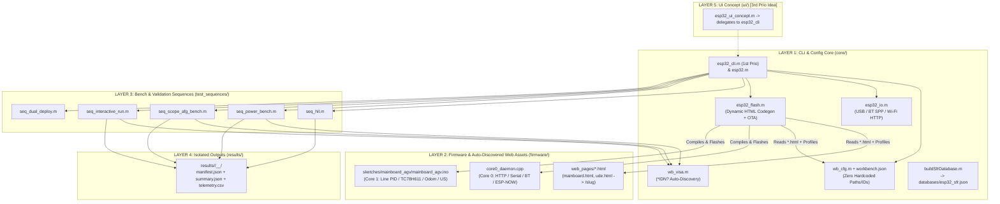
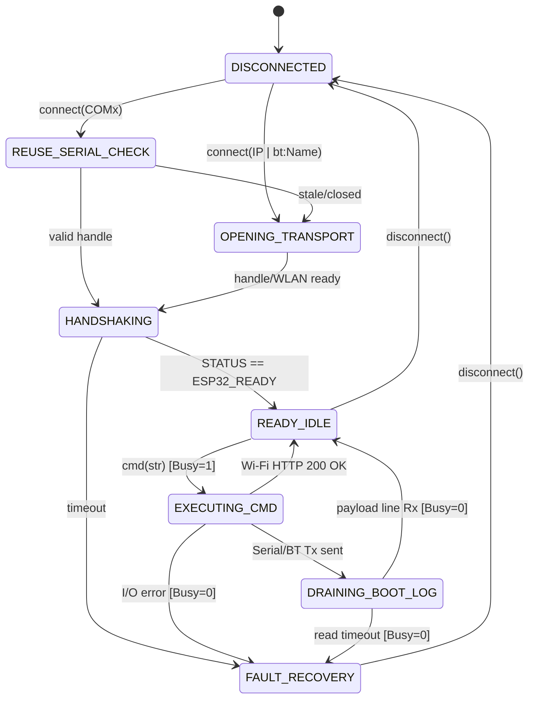
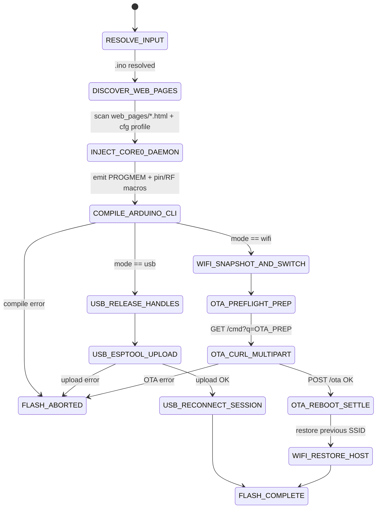
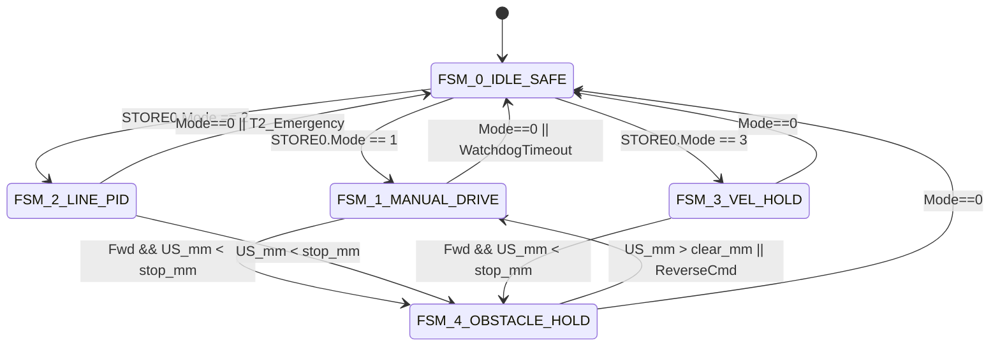

## 1. Architecture Analysis & Aggressive Purge

### Critical Defects Fixed
1. **Silicon Register Collision (`0x3FF4805C` != `STORE4`)**: `core0_daemon.cpp`, `web_ui.html`, `esp32_interactive_testseq.m`, and `green_agv_slam_mapper.m` treated `0x3FF4805C` as `RTC_CNTL_STORE4_REG`. On ESP32, `0x3FF4805C` is **`RTC_CNTL_EXT_XTL_CONF_REG`** (32 kHz crystal control); true `RTC_CNTL_STORE4_REG` is **`0x3FF480B0`**. Fixed everywhere.
2. **Broken HTML Modularization & Hardcoded State**: `esp32_flash.m`, `esp32_hil.m`, and `core0_daemon.cpp` hardcoded `web_ui.html`, `web_ui_agv.html`, `_WEB_UI_UDE`, `_WEB_UI_AGV`, `COM8`, `COM9`, `192.168.4.1`, `ESP32_LAB`, `12345678`, and `USB0::...` VISA strings. Replaced with **dynamic `*.html` directory codegen** (`firmware/web_pages/*.html` $\rightarrow$ C++ `PROGMEM` route table), **CLI-managed `workbench.json`** (`wb_cfg.m`), and **`*IDN?` VISA auto-discovery** (`wb_visa.m`).
3. **Mainboard Pin Collisions**:
   - Old `core0_daemon.cpp` hardcoded `_keysightPin = 4`, colliding with Mainboard Right Motor (`D4`). Separated into `workbench.json -> board_profiles` (`bench_shield` vs `mainboard_rev52a`).
   - Old `web_ui_agv.html` double-assigned `D32` (`Line M` & `Buzzer`) and `D14` (`Red LED` & `Servo SV1`). Parameterized in `board_profiles` (see Section 4 Debt if physical PCB jumpers differ).
4. **Root Pollution & Shared Results**: `esp32_hil.m`, `esp32_keysight_bench.m`, `esp32_interactive_testseq.m`, `esp32_dual_deploy.m` lived at root and appended to shared JSON blobs. Moved to `test_sequences/`; every run writes an isolated folder under `results/<seq>/<YYYYMMDD_HHMMSS>_<profile>/`.
5. **Backwards-Compat & Dead Code Purged**: Deleted `fallback_legacy_wifi`, `D 3FF4804C 5` fallback, `{{WEB_UI_HTML}}`, `copy-gemini*.md`, `walktrough.m`, `beep_fast.ino`, `beep_slow.ino`, `adc_signal_generator.ino`, `esp32_bridge_ota.ino`, `green_agv_cockpit.ino`, `hil_report.json`, `keysight_hil_benchmarks.json`, legacy `esp32_gui.m`, and premature SLAM (`green_agv_slam_mapper.m` deferred to Phase 2).

---

## 2. System Architecture, FSMs & Hardware Diagrams

### 2.1 Refactored 6-Layer Architecture


### 2.2 Explicit Finite State Machines

#### A. Transport & Transaction FSM (`core/esp32_io.m`)


#### B. 12-State Dynamic Build & OTA FSM (`core/esp32_flash.m`)


#### C. Mainboard Core-1 Control FSM (`mainboard_agv.ino`)


---

## 3. Physical Hardware Wiring & Instrument Hookup Guide

### 3.1 Expansion Shield Pin Column Key (`input_file_0.jpeg`)
Every 3-pin bank along both sides of your black expansion shield follows the **exact same outward rule**:
- **Outer pin (closest to white `Dxx` label)** = **`S`** (GPIO Signal)
- **Middle pin** = **`V`** (Power rail selected by `JUMP`: **place black jumper cap on `3.3V–V` (left 2 pins)** — NEVER `5V–V` when wiring sensors/AFG!)
- **Inner pin (closest to ESP32 DevKit)** = **`G`** (`GND`)
- **Top-right 2×4 block**: Left pins = `3.3V` (top 2), `5V` (bottom 2); Right 4 pins = `GND`.

```text
+===================================================================================+
|               BENCH TOPOLOGY: MASTER (SHIELD) <==ESP-NOW==> SLAVE (MAINBOARD)     |
+===================================================================================+
|                                                                                   |
|  [PC / MATLAB] --USB-C (COMx)--> [MASTER ESP32 on Shield]   (Profile: bench_shield)
|     ^                              |-- D4 (S)  ------------> LeCroy C1 (RTT Pulse)|
|     |                              |-- 5V / GND <----------- Keysight CH2 (5.0V)  |
|  USB/LXI VISA                      |                                              |
|     |                              ~~~ 2.4 GHz ESP-NOW Ch.1 ~~~                   |
|     v                                                             v               |
|  +------------------------+                                [SLAVE / STANDALONE    |
|  | KEYSIGHT E36312A PSU   |                                 ESP32 on MAINBOARD]   |
|  |  CH1 (0-6V/5A): 5.00V -+--> Shield 5V/GND (or Mainboard 5V)  (or Battery S2)   |
|  |  CH2 (0-25V/1A): 9.0V -+--> Mainboard TP-BATT+ / Barrel DC6.5-16V (Motors!)    |
|  |  CH3 (0-25V/1A): 0..3V-+--> D34 (S) ONLY during ADC Cal  |                     |
|  |  ALL CH(-) <-----------+--> Common GND Bus <-------------+                     |
|  +------------------------+                                 |                     |
|                                                             |-- D13/D12 -> L Motor|
|  +------------------------+                                 |-- D4 /D2  -> R Motor|
|  | TEKTRONIX AFG3252C     |  [MUST SET: High-Z, 0.0..3.0V]  |-- D18/D19 <- Enc L/R|
|  |  CH1 Out (+) ----------+--> D18(S) EncL  OR  D34(S) LineL|-- D34/32/35 <- Line |
|  |  CH2 Out (+) ----------+--> D19(S) EncR  OR  D35(S) LineR|-- D27/D26 <-> HCSR04|
|  |  BNC Shields (-) ------+--> Common GND Bus               |-- D21/D22 <-> I2C   |
|  +------------------------+                                 +----------+----------+
|                                                                        |          |
|  +------------------------+                                            v          |
|  | LECROY WAVESURFER HD   |  [All Probe GND clips -> Mainboard/Shield GND]        |
|  |  C1 (1x/10x) <---------+-- Master D4 (S)   [ESP-NOW RTT Width ~1.2 ms]         |
|  |  C2 (10x)    <---------+-- Slave/MB D13(S) [Left Motor TC78H611 PWM]           |
|  |  C3 (10x)    <---------+-- Slave/MB D27(S) [HC-SR04 10us Trig] or D26 [Echo]   |
|  |  C4 (10x)    <---------+-- Slave/MB 3V3    [LDO Ripple / Brownout Monitor]     |
|  +------------------------+                                                       |
+===================================================================================+
```

### 3.2 Exact Pin & Instrument Matrix

| Measurement / Test Goal | Node Role | Keysight E36312A | Tektronix AFG3252C *(High-Z, 0..3.0V)* | LeCroy WaveSurfer HD *(Probe GND $\rightarrow$ GND)* |
|---|---|---|---|---|
| **A. Bare SoC Current** *(Photo 1)* | Standalone / Slave | **CH3** `3.30V, 0.5A` $\rightarrow$ `3V3` & `GND` | OFF | **C4** $\rightarrow$ `3V3` |
| **B. LDO Dropout & Logic Power** | Slave on Shield/MB | **CH1** `5.2V..3.4V, 2A` $\rightarrow$ `5V` & `GND` | OFF | **C4** $\rightarrow$ `3V3`, **C1** $\rightarrow$ Master `D4(S)` |
| **C. Master + Slave Wireless RTT** | Master (Shield) + Slave (MB) | **CH2** `5.0V` $\rightarrow$ Master `5V/GND` *(or USB)*; **CH1** `5.0V` $\rightarrow$ Slave `5V/GND` | OFF | **C1** $\rightarrow$ Master `D4(S)` *(Pulse width = RTT)* |
| **D. Encoder / Velocity / Pose Bench Test** *(no wheels spinning)* | Slave / Standalone | **CH1** `5.0V` $\rightarrow$ `5V/GND` *(USB off or CH2=9V motors off)* | **CH1** $\rightarrow$ `D18(S)` (Enc L, `0..3V Sq 50-500Hz`), **CH2** $\rightarrow$ `D19(S)` (Enc R) | **C2** $\rightarrow$ `D18(S)`, **C3** $\rightarrow$ `D19(S)` |
| **E. Line-Follower PID Bench Test** | Standalone / Slave | **CH1** `5.0V` $\rightarrow$ Logic, **CH2** `9.0V` $\rightarrow$ `TP-BATT+` / Barrel | **CH1** $\rightarrow$ `D34(S)` (Line L `0.2..2.8V`), **CH2** $\rightarrow$ `D35(S)` (Line R, $180^\circ$ phase) | **C2** $\rightarrow$ `D13(S)` (Mot L PWM), **C3** $\rightarrow$ `D4(S)` (Mot R PWM) |
| **F. ADC1 Calibration** | Any | **CH3** `0.25..3.00V, 0.05A` $\rightarrow$ `D34(S)` & `GND` | OFF | Optional **C4** $\rightarrow$ `D34(S)` |

> **AFG3252C Safety Rule**: Default output impedance on AFG3252C is `50 Ω`, which **doubles voltage to 6.6 V** into high-Z ESP32 pins. `wb_visa.m` forces `OUTPut1:IMPedance INFinity` and `VOLT:HIGH <= 3.1V` before enabling output.

---

## 4. Efficiency, Latency & Zero-Loss RF Configuration Matrix

| Profile Name | Role | CPU | Wi-Fi Mode | Wi-Fi Power Save | BT SPP | TX Power | Measured Benefit |
|---|---|---|---|---|---|---|---|
| `perf_master` | `MASTER` (1) | 240 MHz | `AP_STA` Ch.1 | `WIFI_PS_NONE` | OFF *(on-demand)* | 17 dBm | Zero 2.4 GHz TDMA collision; **1.1–1.8 ms RTT**, 0% drop |
| `rt_slave` | `SLAVE` (2) | 160 MHz | `STA` Ch.1 | `WIFI_PS_NONE` | Released (`BLE+BT` freed) | 15 dBm | Eliminates modem-sleep DTIM wake jitter on ESP-NOW; ~65 mA logic |
| `eco_slave` | `SLAVE` (2) | 80 MHz | `STA` Ch.1 | `WIFI_PS_MIN_MODEM` | Released | 11 dBm | **~40–48 mA** logic draw (~30h on 1500mAh); wakes to 240 MHz on OTA magic `0xE` |
| `standalone_batt` | `STANDALONE` (0) | 80 MHz | `AP_STA` Ch.1 | `WIFI_PS_NONE` | OFF | 13 dBm | Direct phone/PC HTML control at `192.168.4.1` with reduced peak TX current |

**Why BT Classic hurts latency & power**: Keeping `BluetoothSerial` active shares the single 2.4 GHz radio via coexistence time-slicing, causing 10–40 ms RTT spikes and +45 mA idle draw. Disabling BT by default (`--bt` opt-in only) and using event-driven `SYNC` + 25 ms Master burst keeps ESP-NOW deterministic.

---

## 5. Refactored Codebase

### 5.1 Aggressive Repo Migration & Cleanup (`scripts/reorganize_repo.ps1`)
```powershell
# FILE: scripts/reorganize_repo.ps1
# Run once from repo root: powershell -ExecutionPolicy Bypass -File scripts\reorganize_repo.ps1
param([switch]$Force)

$ErrorActionPreference = "Stop"
$root = (Resolve-Path (Join-Path $PSScriptRoot "..")).Path
Set-Location $root

Write-Host "[1/4] Creating layered directory structure..." -ForegroundColor Cyan
$dirs = @(
    "core",
    "firmware\core0_daemon",
    "firmware\web_pages",
    "firmware\sketches\mainboard_agv",
    "firmware\build_last",
    "test_sequences",
    "databases",
    "results\hil",
    "results\power_bench",
    "results\scope_afg",
    "results\interactive",
    "scripts",
    "ui"
)
foreach ($d in $dirs) { New-Item -ItemType Directory -Path (Join-Path $root $d) -Force | Out-Null }

Write-Host "[2/4] Purging dead, duplicate, and legacy backwards-compat files..." -ForegroundColor Yellow
$obsolete = @(
    "copy-gemini.md",
    "copy-gemini-copz.md",
    "walktrough.m",
    "hil_report.json",
    "databases\keysight_hil_benchmarks.json",
    "firmware\esp32_bridge_ota\adc_signal_generator.ino",
    "firmware\esp32_bridge_ota\beep_fast.ino",
    "firmware\esp32_bridge_ota\beep_slow.ino",
    "firmware\esp32_bridge_ota\esp32_bridge_ota.ino",
    "firmware\esp32_bridge_ota\green_agv_cockpit.ino",
    "firmware\core0_daemon\web_ui.html",
    "firmware\core0_daemon\web_ui_agv.html",
    "green_agv_slam_mapper.m",      # Deferred until Phase 1 hardware validation passes
    "esp32_gui.m"                   # Replaced by thin ui/esp32_ui_concept.m
)
foreach ($f in $obsolete) {
    $p = Join-Path $root $f
    if (Test-Path $p) {
        Remove-Item $p -Force
        Write-Host "  DELETED: $f" -ForegroundColor DarkYellow
    }
}
$oldSketchDir = Join-Path $root "firmware\esp32_bridge_ota"
if ((Test-Path $oldSketchDir) -and ((Get-ChildItem $oldSketchDir | Measure-Object).Count -eq 0)) {
    Remove-Item $oldSketchDir -Force
}

Write-Host "[3/4] Removing old root copies of relocated scripts (after new files are placed)..." -ForegroundColor Cyan
$relocatedOld = @(
    "esp32.m", "esp32_cli.m", "esp32_io.m", "esp32_flash.m", "buildSfrDatabase.m",
    "esp32_hil.m", "esp32_keysight_bench.m", "esp32_interactive_testseq.m",
    "esp32_dual_deploy.m", "run_hil.cmd"
)
foreach ($f in $relocatedOld) {
    $p = Join-Path $root $f
    if (Test-Path $p) {
        Remove-Item $p -Force
        Write-Host "  REMOVED ROOT DUPLICATE: $f" -ForegroundColor DarkGray
    }
}

Write-Host "[4/4] Done. Next run: powershell -ExecutionPolicy Bypass -File setup_cli.ps1" -ForegroundColor Green
```

---

### 5.2 Dynamic Workspace Manifest (`workbench.json`) & CLI Runners

```json
{
  "schema_version": 2,
  "paths": {
    "core": "core",
    "firmware": "firmware",
    "core0_daemon": "firmware/core0_daemon/core0_daemon.cpp",
    "web_pages_dir": "firmware/web_pages",
    "sketches_dir": "firmware/sketches",
    "build_last_dir": "firmware/build_last",
    "test_sequences": "test_sequences",
    "databases": "databases",
    "sfr_json": "databases/esp32_sfr.json",
    "hw_cal_json": "databases/esp32_hw_cal.json",
    "results": "results",
    "ui": "ui"
  },
  "toolchain": {
    "arduino_cli": "",
    "fqbn": "esp32:esp32:esp32:PartitionScheme=min_spiffs",
    "max_ota_bytes": 1966080
  },
  "transport": {
    "master_port": "",
    "slave_port": "",
    "baud": 115200,
    "wifi_ssid": "ESP32_LAB",
    "wifi_pass": "12345678",
    "wifi_ip": "192.168.4.1",
    "slave_ota_ssid": "ESP32_AGV_OTA",
    "bt_name": "ESP32_BT_BRIDGE",
    "espnow_channel": 1,
    "serial_timeout_s": 1.2,
    "wifi_timeout_s": 3.5
  },
  "web": {
    "default_ui": "mainboard"
  },
  "active_board_profile": "mainboard_rev52a",
  "active_rf_profile": "rt_slave",
  "board_profiles": {
    "mainboard_rev52a": {
      "PIN_MOT_L_A": 13,
      "PIN_MOT_L_B": 12,
      "PIN_MOT_R_A": 4,
      "PIN_MOT_R_B": 2,
      "PIN_ENC_L": 18,
      "PIN_ENC_R": 19,
      "PIN_LINE_L": 34,
      "PIN_LINE_M": 32,
      "PIN_LINE_R": 35,
      "PIN_US_TRIG": 27,
      "PIN_US_ECHO": 26,
      "PIN_LED_WHITE_A": 25,
      "PIN_LED_WHITE_B": 33,
      "PIN_LED_RED_A": 23,
      "PIN_LED_RED_B": -1,
      "PIN_BUZZER": -1,
      "PIN_SERVO_SV1": 14,
      "PIN_BTN_T1": 5,
      "PIN_BTN_T2": 15,
      "PIN_I2C_SDA": 21,
      "PIN_I2C_SCL": 22,
      "PIN_SCOPE_TRIG": -1,
      "MOT_PWM_HZ": 5000
    },
    "bench_shield": {
      "PIN_MOT_L_A": 13,
      "PIN_MOT_L_B": 12,
      "PIN_MOT_R_A": 16,
      "PIN_MOT_R_B": 17,
      "PIN_ENC_L": 18,
      "PIN_ENC_R": 19,
      "PIN_LINE_L": 34,
      "PIN_LINE_M": 32,
      "PIN_LINE_R": 35,
      "PIN_US_TRIG": 27,
      "PIN_US_ECHO": 26,
      "PIN_LED_WHITE_A": 25,
      "PIN_LED_WHITE_B": 33,
      "PIN_LED_RED_A": 23,
      "PIN_LED_RED_B": -1,
      "PIN_BUZZER": -1,
      "PIN_SERVO_SV1": 14,
      "PIN_BTN_T1": 5,
      "PIN_BTN_T2": 15,
      "PIN_I2C_SDA": 21,
      "PIN_I2C_SCL": 22,
      "PIN_SCOPE_TRIG": 4,
      "MOT_PWM_HZ": 5000
    }
  },
  "kinematics": {
    "mm_per_tick": 3.40,
    "wheelbase_mm": 128.0,
    "obstacle_stop_mm": 150,
    "obstacle_clear_mm": 220,
    "line_adc_thresh": 1800,
    "line_active_low": 0,
    "pid_kp": 28.0,
    "pid_ki": 0.4,
    "pid_kd": 6.5,
    "line_base_pct": 55,
    "cmd_watchdog_ms": 0
  },
  "rf_profiles": {
    "perf_master": {
      "cpu_mhz": 240,
      "wifi_ps": 0,
      "bt_enable": 0,
      "tx_power_quarter_dbm": 68,
      "espnow_period_ms": 25
    },
    "rt_slave": {
      "cpu_mhz": 160,
      "wifi_ps": 0,
      "bt_enable": 0,
      "tx_power_quarter_dbm": 60,
      "espnow_period_ms": 25
    },
    "eco_slave": {
      "cpu_mhz": 80,
      "wifi_ps": 1,
      "bt_enable": 0,
      "tx_power_quarter_dbm": 44,
      "espnow_period_ms": 50
    },
    "standalone_batt": {
      "cpu_mhz": 80,
      "wifi_ps": 0,
      "bt_enable": 0,
      "tx_power_quarter_dbm": 52,
      "espnow_period_ms": 25
    }
  },
  "instruments": {
    "psu": {
      "visa": "",
      "idn_match": "E36312A",
      "ch_logic": 1,
      "ch_motor": 2,
      "ch_cal": 3,
      "v_logic": 5.0,
      "i_logic": 2.0,
      "v_motor": 9.0,
      "i_motor": 1.0
    },
    "scope": {
      "visa": "",
      "idn_match": "WAVESURFER|LECROY|LCRY",
      "ch_rtt": 1,
      "ch_pwm": 2,
      "ch_us": 3,
      "ch_rail": 4
    },
    "afg": {
      "visa": "",
      "idn_match": "AFG3252",
      "v_low": 0.0,
      "v_high": 3.0,
      "impedance": "INF"
    }
  }
}
```

```powershell
# FILE: setup_cli.ps1
$ErrorActionPreference = "Stop"
$root = $PSScriptRoot

Write-Host "=== ESP32 Workbench Setup ===" -ForegroundColor Cyan
if (-not (Get-Command arduino-cli -ErrorAction SilentlyContinue)) {
    winget install ArduinoSA.CLI --silent --accept-package-agreements --accept-source-agreements
}
$acli = (Get-Command arduino-cli).Source
& $acli config init --overwrite | Out-Null
& $acli config add board_manager.additional_urls https://espressif.github.io/arduino-esp32/package_esp32_index.json
& $acli core update-index
& $acli core install esp32:esp32

$matlabCmd = "addpath(genpath('$root')); wb_cfg('init'); buildSfrDatabase(); esp32_cli('cfg','discover');"
Write-Host "Bootstrapping MATLAB paths, SFR DB, and hardware discovery..." -ForegroundColor Yellow
matlab -batch $matlabCmd
```

```batch
@echo off
REM FILE: scripts/run_hil.cmd
setlocal
set MODE=%~1
if "%MODE%"=="" set MODE=quick
set ROOT=%~dp0..
matlab -batch "addpath(genpath('%ROOT%')); wb_cfg('init'); esp32_cli('seq','run','seq_hil','%MODE%');"
```

---

### 5.3 Core Engine (`core/`)

#### `core/wb_cfg.m`
```matlab
function out = wb_cfg(action, varargin)
%WB_CFG Dynamic Workspace Path, Configuration & Run-Directory Engine.
%   Zero hardcoded paths, COM ports, IPs, or VISA IDs.
%   Usage:
%     cfg = wb_cfg('init')
%     val = wb_cfg('get', 'transport.wifi_ip')
%     wb_cfg('set', 'transport.master_port', 'COM8')
%     wb_cfg('discover')
%     p   = wb_cfg('path', 'web_pages_dir')
%     rd  = wb_cfg('run_dir', 'power_bench', 'rt_slave')

    if nargin < 1 || isempty(action), action = 'get'; end
    act = lower(strtrim(char(action)));

    coreDir = fileparts(mfilename('fullpath'));
    rootDir = fileparts(coreDir);
    cfgFile = fullfile(rootDir, 'workbench.json');

    switch act
        case 'root'
            out = rootDir;

        case 'init'
            addpath(coreDir);
            cfg = load_cfg(cfgFile);
            subKeys = {'test_sequences', 'ui'};
            for i = 1:numel(subKeys)
                k = subKeys{i};
                if isfield(cfg.paths, k)
                    d = fullfile(rootDir, cfg.paths.(k));
                    if isfolder(d), addpath(d); end
                end
            end
            out = cfg;

        case 'get'
            cfg = load_cfg(cfgFile);
            if isempty(varargin)
                out = cfg;
                return;
            end
            out = get_nested(cfg, char(varargin{1}));

        case 'set'
            if numel(varargin) < 2
                error('wb_cfg:SetArgs', 'Usage: wb_cfg(''set'', ''dot.key'', value)');
            end
            cfg = load_cfg(cfgFile);
            cfg = set_nested(cfg, char(varargin{1}), parse_typed_val(varargin{2}));
            save_cfg(cfgFile, cfg);
            out = cfg;

        case 'path'
            cfg = load_cfg(cfgFile);
            key = char(varargin{1});
            if isfield(cfg.paths, key)
                rel = cfg.paths.(key);
            else
                rel = key;
            end
            out = fullfile(rootDir, rel);

        case 'run_dir'
            if isempty(varargin), error('Usage: wb_cfg(''run_dir'', seqName, [tag])'); end
            seqName = regexprep(char(varargin{1}), '[^a-zA-Z0-9_-]', '_');
            tag = 'default';
            if numel(varargin) >= 2 && ~isempty(varargin{2})
                tag = regexprep(char(varargin{2}), '[^a-zA-Z0-9_-]', '_');
            end
            ts = char(datetime('now', 'Format', 'yyyyMMdd_HHmmss'));
            resRoot = wb_cfg('path', 'results');
            out = fullfile(resRoot, seqName, [ts '_' tag]);
            if ~isfolder(out), mkdir(out); end

        case 'discover'
            cfg = load_cfg(cfgFile);
            % 1. Discover arduino-cli
            [st, acOut] = system('where arduino-cli 2>nul');
            if st == 0
                lines = splitlines(string(strtrim(acOut)));
                cfg.toolchain.arduino_cli = char(lines(1));
            end
            % 2. Discover USB Serial ESP32 ports
            ports = discover_usb_ports(cfg.toolchain.arduino_cli);
            if ~isempty(ports)
                if isempty(cfg.transport.master_port), cfg.transport.master_port = ports{1}; end
                if numel(ports) >= 2 && isempty(cfg.transport.slave_port), cfg.transport.slave_port = ports{2}; end
            end
            % 3. Discover VISA Instruments via *IDN?
            if exist('wb_visa', 'file') == 2
                found = wb_visa('discover');
                roles = fieldnames(cfg.instruments);
                for r = 1:numel(roles)
                    rn = roles{r};
                    if isfield(found, rn) && ~isempty(found.(rn))
                        cfg.instruments.(rn).visa = found.(rn);
                    end
                end
            end
            save_cfg(cfgFile, cfg);
            out = cfg;

        case 'show'
            out = load_cfg(cfgFile);
            fprintf('%s\n', jsonencode(out, 'PrettyPrint', true));

        otherwise
            error('wb_cfg:UnknownAction', 'Unknown action: %s', act);
    end
end

function cfg = load_cfg(cfgFile)
    if ~isfile(cfgFile)
        error('wb_cfg:MissingManifest', 'workbench.json not found at %s', cfgFile);
    end
    cfg = jsondecode(fileread(cfgFile));
end

function save_cfg(cfgFile, cfg)
    fid = fopen(cfgFile, 'w', 'n', 'UTF-8');
    fwrite(fid, jsonencode(cfg, 'PrettyPrint', true), 'char');
    fclose(fid);
end

function val = get_nested(s, dotKey)
    parts = strsplit(dotKey, '.');
    val = s;
    for i = 1:numel(parts)
        if ~isstruct(val) || ~isfield(val, parts{i})
            error('wb_cfg:KeyNotFound', 'Config key not found: %s', dotKey);
        end
        val = val.(parts{i});
    end
end

function s = set_nested(s, dotKey, val)
    parts = strsplit(dotKey, '.');
    if numel(parts) == 1
        s.(parts{1}) = val;
        return;
    end
    cur = struct();
    if isfield(s, parts{1}) && isstruct(s.(parts{1}))
        cur = s.(parts{1});
    end
    s.(parts{1}) = set_nested(cur, strjoin(parts(2:end), '.'), val);
end

function v = parse_typed_val(in)
    if isnumeric(in) || islogical(in), v = in; return; end
    str = strtrim(char(in));
    if strcmpi(str, 'true'), v = true; return; end
    if strcmpi(str, 'false'), v = false; return; end
    num = str2double(str);
    if ~isnan(num) && ~isempty(regexp(str, '^[+-]?\d+(\.\d+)?$', 'once'))
        v = num;
    else
        v = str;
    end
end

function ports = discover_usb_ports(acli)
    ports = {};
    if ~isempty(acli)
        [~, out] = system(sprintf('"%s" board list 2>nul', acli));
        lines = splitlines(string(strtrim(out)));
        for k = 1:numel(lines)
            if contains(lines(k), "Serial Port (USB)", "IgnoreCase", true)
                tok = split(strtrim(lines(k)));
                ports{end+1} = char(tok(1)); %#ok<AGROW>
            end
        end
    end
    if isempty(ports)
        avail = serialportlist("available");
        ports = cellstr(avail);
    end
end
```

#### `core/wb_visa.m`
```matlab
function varargout = wb_visa(action, varargin)
%WB_VISA Auto-Discovering SCPI Driver for Keysight E36312A, LeCroy WaveSurfer HD, Tektronix AFG3252C.
%   Zero hardcoded VISA addresses: matches connected USB/LXI resources by *IDN? regex in workbench.json.

    act = lower(strtrim(char(action)));
    switch act
        case 'discover'
            varargout{1} = discover_instruments();

        case 'open'
            role = lower(strtrim(char(varargin{1})));
            instCfg = wb_cfg('get', ['instruments.' role]);
            addr = '';
            if isfield(instCfg, 'visa') && ~isempty(instCfg.visa)
                addr = char(instCfg.visa);
            else
                found = discover_instruments();
                if isfield(found, role) && ~isempty(found.(role))
                    addr = found.(role);
                    wb_cfg('set', ['instruments.' role '.visa'], addr);
                end
            end
            if isempty(addr)
                error('wb_visa:NotFound', 'No instrument matching "%s" (%s) found via VISA.', role, instCfg.idn_match);
            end
            h = open_visa_session(addr, role);
            varargout{1} = h;

        case 'write'
            h = varargin{1}; cmd = char(varargin{2});
            if h.IsDotNet, h.IO.WriteLine(cmd); else, writeline(h.Dev, cmd); end

        case 'query'
            h = varargin{1}; cmd = char(varargin{2});
            if h.IsDotNet
                h.IO.WriteLine(cmd);
                varargout{1} = strtrim(char(h.IO.ReadLine()));
            else
                varargout{1} = strtrim(char(writeread(h.Dev, cmd)));
            end

        case 'close'
            h = varargin{1};
            try
                if h.IsDotNet
                    if ~isempty(h.Session), h.Session.Dispose(); end
                    if ~isempty(h.RM), h.RM.Dispose(); end
                else
                    delete(h.Dev);
                end
            catch
            end

        case 'afg_safe_highz'
            h = varargin{1}; ch = 1;
            if numel(varargin) >= 2, ch = double(varargin{2}); end
            afgCfg = wb_cfg('get', 'instruments.afg');
            wb_visa('write', h, sprintf('OUTPut%d:STATe OFF', ch));
            wb_visa('write', h, sprintf('OUTPut%d:IMPedance %s', ch, afgCfg.impedance));
            wb_visa('write', h, sprintf('SOURce%d:VOLTage:LIMit:HIGH %.3f', ch, afgCfg.v_high + 0.2));
            wb_visa('write', h, sprintf('SOURce%d:VOLTage:LIMit:LOW %.3f', ch, afgCfg.v_low));

        otherwise
            error('wb_visa:BadAction', 'Unknown action: %s', act);
    end
end

function found = discover_instruments()
    found = struct();
    instAll = wb_cfg('get', 'instruments');
    roles = fieldnames(instAll);
    resList = list_all_visa_resources();

    for i = 1:numel(resList)
        rAddr = char(resList{i});
        try
            h = open_visa_session(rAddr, 'probe');
            idn = wb_visa('query', h, '*IDN?');
            wb_visa('close', h);
            for r = 1:numel(roles)
                rn = roles{r};
                pat = instAll.(rn).idn_match;
                if ~isempty(regexp(idn, pat, 'ignorecase', 'once'))
                    found.(rn) = rAddr;
                    fprintf('  [VISA DISCOVERED] %-6s -> %s (%s)\n', upper(rn), rAddr, idn);
                end
            end
        catch
        end
    end
end

function list = list_all_visa_resources()
    list = {};
    try
        tbl = visadevlist;
        if ~isempty(tbl) && ismember('ResourceName', tbl.Properties.VariableNames)
            list = cellstr(tbl.ResourceName);
            return;
        end
    catch
    end
    try
        load_dotnet_visa();
        col = Ivi.Visa.GlobalResourceManager.Find('USB?*INSTR');
        it = col.GetEnumerator();
        while it.MoveNext()
            list{end+1} = char(it.Current); %#ok<AGROW>
        end
    catch
    end
end

function h = open_visa_session(addr, role)
    try
        v = visadev(addr);
        v.Timeout = 5.0;
        configureTerminator(v, 'LF');
        h = struct('IsDotNet', false, 'Dev', v, 'Role', role, 'Addr', addr);
        return;
    catch
    end
    load_dotnet_visa();
    rm = [];
    try
        rm = Keysight.Visa.ResourceManager();
        sess = rm.Open(char(addr));
    catch
        sess = Ivi.Visa.GlobalResourceManager.Open(char(addr));
    end
    sess.TimeoutMilliseconds = 5000;
    sess.TerminationCharacter = 10;
    sess.TerminationCharacterEnabled = true;
    sess.Clear();
    io = Ivi.Visa.FormattedIO.MessageBasedFormattedIO(sess);
    h = struct('IsDotNet', true, 'Session', sess, 'RM', rm, 'IO', io, 'Role', role, 'Addr', addr);
end

function load_dotnet_visa()
    NET.addAssembly('Ivi.Visa');
    try
        NET.addAssembly('Keysight.Visa');
    catch
        dlls = [dir('C:\Windows\Microsoft.NET\assembly\**\Keysight.Visa.dll'); ...
                dir('C:\Program Files*\Keysight\**\Keysight.Visa.dll'); ...
                dir('C:\Program Files*\IVI Foundation\**\Keysight.Visa.dll')];
        if ~isempty(dlls), NET.addAssembly(fullfile(dlls(1).folder, dlls(1).name)); end
    end
end
```

#### `core/esp32_io.m`
```matlab
function [out, latencyMs] = esp32_io(action, varargin)
%ESP32_IO Explicit Transport FSM (USB Serial / Bluetooth SPP / Wi-Fi HTTP).
%   Zero hardcoded SSIDs, passwords, ports, or legacy HTTP fallbacks.

    s = get_state();
    out = ''; latencyMs = 0;
    if nargin < 1 || isempty(action), action = 'state'; end
    act = lower(strtrim(char(action)));

    switch act
        case 'state'
            out = s;

        case 'verbose'
            if ~isempty(varargin)
                arg = varargin{1};
                if islogical(arg) || isnumeric(arg)
                    s.Verbose = logical(arg);
                else
                    s.Verbose = any(strcmpi(strtrim(char(arg)), {'on', 'true', '1', 'yes'}));
                end
                set_state(s);
            end
            out = s.Verbose;

        case 'trace'
            if numel(varargin) >= 3
                s = log_fsm_event(s, char(varargin{1}), char(varargin{2}), char(varargin{3}));
            end
            out = true;

        case 'history'
            for k = 1:numel(s.TraceHistory), fprintf('%s\n', s.TraceHistory(k)); end
            if nargout > 0, out = s.TraceHistory; end

        case 'connect'
            tCfg = wb_cfg('get', 'transport');
            if isempty(varargin) || isempty(varargin{1})
                target = resolve_default_target(tCfg);
            else
                target = strtrim(char(varargin{1}));
            end

            forceBt = numel(varargin) >= 2 && (ischar(varargin{2}) || isstring(varargin{2})) && ...
                      any(strcmpi(char(varargin{2}), {'--bt', 'bt', 'bluetooth'}));
            isSerial = startsWith(upper(target), 'COM') || startsWith(target, '/dev/');
            isIpv4   = ~isempty(regexp(target, '^(https?://)?\d+\.\d+\.\d+\.\d+', 'once'));
            isBtMac  = ~isempty(regexp(target, '^([0-9A-Fa-f]{2}[:-]){5}([0-9A-Fa-f]{2})$', 'once'));
            hasBtPre = startsWith(lower(target), 'bt:') || startsWith(lower(target), 'bluetooth:');

            if isSerial && ~forceBt
                s = transition_fsm(s, 'REUSE_SERIAL_CHECK', ['Checking ' upper(target)]);
                if strcmp(s.Mode, 'serial') && strcmpi(s.Target, target) && ~isempty(s.SerialObj) && isvalid(s.SerialObj)
                    try
                        s = transition_fsm(s, 'HANDSHAKING', 'Probing existing Serial handle');
                        [resp, latencyMs] = execute_wire_transaction(s, 'STATUS');
                        if contains(resp, 'ESP32_READY')
                            s = get_state();
                            transition_fsm(s, 'READY_IDLE', sprintf('Reused %s (%.1f ms)', s.Target, latencyMs));
                            out = true; return;
                        end
                    catch
                        s = get_state();
                    end
                end
                esp32_io('disconnect'); s = get_state();
                baud = tCfg.baud;
                if numel(varargin) >= 2 && isnumeric(varargin{2}), baud = double(varargin{2}); end

                s = transition_fsm(s, 'OPENING_TRANSPORT', sprintf('serialport("%s", %d)', upper(target), baud));
                release_existing_port(target);
                sp = serialport(target, baud, 'Timeout', tCfg.serial_timeout_s);
                configureTerminator(sp, "LF");
                pause(0.30); flush(sp);
                s.Mode = 'serial'; s.Target = upper(target); s.SerialObj = sp;
                set_state(s);

                s = transition_fsm(s, 'HANDSHAKING', 'Sending STATUS');
                resp = '';
                for attempt = 1:3
                    try
                        [resp, latencyMs] = execute_wire_transaction(s, 'STATUS');
                        if contains(resp, 'ESP32_READY'), break; end
                    catch
                        pause(0.4);
                    end
                end
                s = get_state();
                transition_fsm(s, 'READY_IDLE', sprintf('Connected %s (%.1f ms)', s.Target, latencyMs));
                fprintf('[ESP32] Serial %s (%.1f ms) -> %s\n', s.Target, latencyMs, resp);
                out = true;

            elseif hasBtPre || isBtMac || forceBt || (~isIpv4 && ~contains(target, '.'))
                esp32_io('disconnect'); s = get_state();
                btTarget = regexprep(target, '^(?i)(bt:|bluetooth:)', '');
                if isempty(btTarget), btTarget = tCfg.bt_name; end
                ch = 1;
                if numel(varargin) >= 2 && isnumeric(varargin{2}), ch = double(varargin{2}); end

                s = transition_fsm(s, 'OPENING_TRANSPORT', sprintf('BT SPP "%s" Ch.%d', btTarget, ch));
                btObj = bluetooth(btTarget, ch, 'Timeout', tCfg.wifi_timeout_s);
                configureTerminator(btObj, "LF"); flush(btObj); pause(0.15); flush(btObj);
                s.Mode = 'bluetooth'; s.Target = btTarget; s.SerialObj = btObj;
                set_state(s);

                s = transition_fsm(s, 'HANDSHAKING', 'BT STATUS');
                [resp, latencyMs] = execute_wire_transaction(s, 'STATUS');
                s = get_state();
                transition_fsm(s, 'READY_IDLE', sprintf('BT Ready (%.1f ms)', latencyMs));
                fprintf('[ESP32] BT SPP %s (%.1f ms) -> %s\n', s.Target, latencyMs, resp);
                out = true;

            else
                esp32_io('disconnect'); s = get_state();
                ip = regexprep(regexprep(target, '^https?://', ''), '/.*$', '');
                s = transition_fsm(s, 'OPENING_TRANSPORT', ['Wi-Fi http://' ip]);
                if strcmp(ip, tCfg.wifi_ip) && ispc
                    ensure_ap_connected(tCfg.wifi_ssid, tCfg.wifi_pass, ip, s);
                end
                s.Mode = 'wifi'; s.Target = ip; s.SerialObj = [];
                set_state(s);

                s = transition_fsm(s, 'HANDSHAKING', 'HTTP /cmd?q=STATUS');
                [resp, latencyMs] = execute_wire_transaction(s, 'STATUS');
                s = get_state();
                transition_fsm(s, 'READY_IDLE', sprintf('Wi-Fi Ready (%.1f ms)', latencyMs));
                fprintf('[ESP32] Wi-Fi http://%s (%.1f ms) -> %s\n', ip, latencyMs, resp);
                out = true;
            end

        case 'disconnect'
            if ~isempty(s.SerialObj) && isvalid(s.SerialObj)
                try flush(s.SerialObj); delete(s.SerialObj); catch, end
            end
            s.Mode = 'none'; s.Target = ''; s.SerialObj = []; s.Busy = false;
            transition_fsm(s, 'DISCONNECTED', 'Transport released');
            out = true;

        case {'cmd', 'send', 'raw', 'exec'}
            rawCmd = strtrim(char(strjoin(string(varargin), ' ')));
            if strcmp(s.Mode, 'none') || strcmp(s.Phase, 'DISCONNECTED')
                error('esp32_io:NotConnected', 'Disconnected. Run: esp32_cli connect <target>');
            end
            if s.Busy, out = 'BUSY'; return; end
            [out, latencyMs] = execute_wire_transaction(s, rawCmd);

        otherwise
            error('esp32_io:UnknownAction', 'Unknown action: %s', act);
    end
end

function [out, latencyMs] = execute_wire_transaction(s, rawCmd)
    tCfg = wb_cfg('get', 'transport');
    s = transition_fsm(s, 'EXECUTING_CMD', sprintf('%s -> "%s"', upper(s.Mode), rawCmd));
    t0 = tic;
    try
        if any(strcmp(s.Mode, {'serial', 'bluetooth'}))
            flush(s.SerialObj);
            writeline(s.SerialObj, rawCmd);
            s = transition_fsm(s, 'DRAINING_BOOT_LOG', 'Awaiting response');
            out = drain_boot_banners(s.SerialObj);
        else
            opts = weboptions('Timeout', tCfg.wifi_timeout_s, 'ContentType', 'text');
            url = sprintf('http://%s/cmd?q=%s', s.Target, urlencode(rawCmd));
            out = strtrim(char(webread(url, opts)));
        end
        latencyMs = toc(t0) * 1000.0;
        transition_fsm(s, 'READY_IDLE', sprintf('Rx <- "%s" (%.1f ms)', out, latencyMs));
    catch ME
        transition_fsm(s, 'FAULT_RECOVERY', ME.message);
        rethrow(ME);
    end
end

function payload = drain_boot_banners(serialObj)
    bootPrefixes = ["ets ", "rst:", "mode:", "load:", "entry ", "configsip:", "clk_drv:", "ho 0 "];
    while true
        lineStr = strtrim(char(readline(serialObj)));
        if ~any(startsWith(string(lineStr), bootPrefixes)) && ~strcmp(lineStr, 'ESP32_READY')
            payload = lineStr;
            return;
        end
    end
end

function target = resolve_default_target(tCfg)
    if ~isempty(tCfg.master_port), target = tCfg.master_port; return; end
    wb_cfg('discover');
    tCfg = wb_cfg('get', 'transport');
    if ~isempty(tCfg.master_port), target = tCfg.master_port; return; end
    target = tCfg.wifi_ip;
end

function ensure_ap_connected(ssid, pass, ip, s)
    [~, wlanInfo] = system('netsh wlan show interfaces');
    if contains(wlanInfo, ssid) && is_pingable(ip), return; end
    log_fsm_event(s, 'esp32_io.m', 'WIFI_AP_SWITCH', ['Connecting WLAN to ' ssid]);
    xml = sprintf([ ...
        '<?xml version="1.0"?><WLANProfile xmlns="http://www.microsoft.com/networking/WLAN/profile/v1">' ...
        '<name>%s</name><SSIDConfig><SSID><name>%s</name></SSID></SSIDConfig>' ...
        '<connectionType>ESS</connectionType><connectionMode>manual</connectionMode><MSM><security>' ...
        '<authEncryption><authentication>WPA2PSK</authentication><encryption>AES</encryption><useOneX>false</useOneX></authEncryption>' ...
        '<sharedKey><keyType>passPhrase</keyType><protected>false</protected><keyMaterial>%s</keyMaterial></sharedKey>' ...
        '</security></MSM></WLANProfile>'], ssid, ssid, pass);
    xmlPath = fullfile(tempdir, 'esp32_wlan_profile.xml');
    fid = fopen(xmlPath, 'w'); fwrite(fid, xml, 'char'); fclose(fid);
    system(sprintf('netsh wlan add profile filename="%s" >nul 2>&1', xmlPath));
    system(sprintf('netsh wlan connect name="%s" >nul 2>&1', ssid));
    for k = 1:10
        pause(1.0);
        [~, wOut] = system('netsh wlan show interfaces');
        if contains(wOut, ssid) && is_pingable(ip), return; end
    end
    warning('esp32_io:WifiTimeout', 'Could not reach %s on SSID "%s".', ip, ssid);
end

function ok = is_pingable(ip)
    [st, pOut] = system(sprintf('ping -n 1 -w 500 %s', ip));
    ok = (st == 0) && contains(pOut, 'TTL=', 'IgnoreCase', true);
end

function release_existing_port(targetPort)
    try
        objs = serialportfind('Port', upper(string(targetPort)));
        for k = 1:numel(objs), try delete(objs(k)); catch, end; end
    catch
    end
end

function s = transition_fsm(s, nextPhase, msg)
    prev = s.Phase; s.Phase = nextPhase;
    s.Busy = ~ismember(nextPhase, {'DISCONNECTED', 'READY_IDLE', 'FAULT_RECOVERY'});
    if strcmp(nextPhase, 'FAULT_RECOVERY'), s.LastError = msg; end
    s.LastTransition = sprintf('%s -> %s', prev, nextPhase);
    s = log_fsm_event(s, 'esp32_io.m', ['FSM: ' s.LastTransition], msg);
    set_state(s);
end

function s = log_fsm_event(s, fileTag, fsmTag, msg)
    ts = char(datetime('now', 'Format', 'HH:mm:ss.SSS'));
    entry = sprintf('[TRACE %s] [%-14s] [%-30s] %s', ts, fileTag, fsmTag, msg);
    s.TraceHistory(end+1) = string(entry);
    if numel(s.TraceHistory) > 150, s.TraceHistory = s.TraceHistory(end-149:end); end
    if s.Verbose, fprintf('%s\n', entry); end
    set_state(s);
end

function s = get_state()
    if isappdata(0, 'ESP32_WORKBENCH_STATE')
        s = getappdata(0, 'ESP32_WORKBENCH_STATE');
    else
        s = struct('Phase', 'DISCONNECTED', 'Mode', 'none', 'Target', '', 'SerialObj', [], ...
            'Busy', false, 'Verbose', false, 'LastTransition', 'INIT', 'LastError', '', ...
            'TraceHistory', strings(0, 1));
        setappdata(0, 'ESP32_WORKBENCH_STATE', s);
    end
end
function set_state(s), setappdata(0, 'ESP32_WORKBENCH_STATE', s); end
```

#### `core/esp32_flash.m`
```matlab
function [success, buildId] = esp32_flash(filePath, varargin)
%ESP32_FLASH 12-State Deployment FSM with Dynamic *.html Discovery & Board/RF Profile Codegen.
%   Zero hardcoded HTML names, paths, COM ports, IPs, SSIDs, or pin numbers.
%   Usage:
%     esp32_flash('mainboard_agv', '--usb', 'master', '--role', 'master', '--board', 'bench_shield', '--rf', 'perf_master')
%     esp32_flash('mainboard_agv', '--wifi', '--role', 'standalone', '--board', 'mainboard_rev52a', '--rf', 'standalone_batt')

    cfg = wb_cfg('get');
    if nargin < 1 || isempty(filePath)
        sketches = dir(fullfile(wb_cfg('path', 'sketches_dir'), '*', '*.ino'));
        if isempty(sketches), error('esp32_flash:NoSketches', 'No sketches found.'); end
        filePath = fullfile(sketches(1).folder, sketches(1).name);
    else
        filePath = resolve_sketch_path(char(filePath), cfg);
    end

    s = esp32_io('state');
    mode = ''; target = '';
    nodeRole = 'standalone';
    uiSlug = cfg.web.default_ui;
    boardName = cfg.active_board_profile;
    rfName = '';
    restoreWifi = true;

    i = 1;
    while i <= numel(varargin)
        arg = strtrim(char(varargin{i})); aLow = lower(arg);
        if any(strcmp(aLow, {'--wifi', '-w', 'wifi'}))
            mode = 'wifi';
            if i < numel(varargin) && ~startsWith(char(varargin{i+1}), '-'), target = char(varargin{i+1}); i = i + 1; end
        elseif any(strcmp(aLow, {'--usb', '-u', 'usb'}))
            mode = 'usb';
            if i < numel(varargin) && ~startsWith(char(varargin{i+1}), '-'), target = char(varargin{i+1}); i = i + 1; end
        elseif any(strcmp(aLow, {'--role', '-r'})) && i < numel(varargin)
            nodeRole = lower(char(varargin{i+1})); i = i + 1;
        elseif any(strcmp(aLow, {'--ui', '--html'})) && i < numel(varargin)
            uiSlug = lower(char(varargin{i+1})); i = i + 1;
        elseif any(strcmp(aLow, {'--board', '-b'})) && i < numel(varargin)
            boardName = char(varargin{i+1}); i = i + 1;
        elseif any(strcmp(aLow, {'--rf', '--power'})) && i < numel(varargin)
            rfName = char(varargin{i+1}); i = i + 1;
        elseif strcmp(aLow, '--keep-wifi')
            restoreWifi = false;
        end
        i = i + 1;
    end

    if isempty(rfName)
        switch nodeRole
            case 'master', rfName = 'perf_master';
            case 'slave',  rfName = 'rt_slave';
            otherwise,     rfName = cfg.active_rf_profile;
        end
    end
    if isempty(mode)
        if strcmp(s.Mode, 'wifi'), mode = 'wifi'; target = s.Target;
        else, mode = 'usb'; end
    end
    if strcmp(mode, 'usb')
        if strcmpi(target, 'master'), target = cfg.transport.master_port;
        elseif strcmpi(target, 'slave'), target = cfg.transport.slave_port;
        end
        if isempty(target)
            wb_cfg('discover'); cfg = wb_cfg('get');
            target = cfg.transport.master_port;
        end
        release_matlab_serial_ports(target);
    elseif isempty(target)
        target = cfg.transport.wifi_ip;
    end

    acli = cfg.toolchain.arduino_cli;
    if isempty(acli), acli = 'arduino-cli'; end
    [~, sketchBase, ext] = fileparts(filePath);
    shortName = upper(regexprep(sketchBase, '[^a-zA-Z0-9]', ''));
    if strlength(shortName) > 8, shortName = extractBefore(shortName, 9); end
    buildId = sprintf('BLD_%s_%s_%s', shortName, upper(nodeRole(1)), char(datetime('now', 'Format', 'HHmmss')));

    buildRoot    = fullfile(tempdir, 'esp32_wb_build');
    sketchDir    = fullfile(buildRoot, 'ota_sketch');
    outBinDir    = fullfile(buildRoot, 'bin');
    lastBuildDir = wb_cfg('path', 'build_last_dir');
    outInoPath   = fullfile(sketchDir, 'ota_sketch.ino');

    ctx = struct('State', 'RESOLVE_INPUT', 'FilePath', filePath, 'Ext', ext, 'Mode', mode, ...
        'Target', target, 'Role', nodeRole, 'UiSlug', uiSlug, 'Board', boardName, 'Rf', rfName, ...
        'BuildId', buildId, 'Pages', [], 'BinFile', '', 'RestoreWifi', restoreWifi, ...
        'PrevSsid', get_wifi_ssid(), 'WasConn', strcmp(s.Mode, 'serial') && strcmpi(s.Target, target));

    if strcmp(ctx.Mode, 'wifi') && ctx.RestoreWifi && ~isempty(ctx.PrevSsid) && ~strcmpi(ctx.PrevSsid, cfg.transport.wifi_ssid)
        wifiGuard = onCleanup(@() restore_wifi_ssid(ctx.PrevSsid)); %#ok<NASGU>
    end

    success = false;
    while ~ismember(ctx.State, {'FLASH_COMPLETE', 'FLASH_ABORTED'})
        switch ctx.State
            case 'RESOLVE_INPUT'
                if strcmpi(ctx.Ext, '.ino')
                    if isfolder(buildRoot), try rmdir(buildRoot, 's'); catch, end; end
                    mkdir(sketchDir); mkdir(outBinDir);
                    if ~isfolder(lastBuildDir), mkdir(lastBuildDir); end
                    ctx.State = 'DISCOVER_WEB_PAGES';
                elseif strcmpi(ctx.Ext, '.bin') && strcmp(ctx.Mode, 'wifi')
                    ctx.BinFile = ctx.FilePath;
                    ctx.State = 'WIFI_SNAPSHOT_AND_SWITCH';
                else
                    error('esp32_flash:InvalidInput', 'Unsupported input/mode: %s (%s)', ctx.FilePath, ctx.Mode);
                end

            case 'DISCOVER_WEB_PAGES'
                pagesDir = wb_cfg('path', 'web_pages_dir');
                htmlFiles = dir(fullfile(pagesDir, '*.html'));
                if isempty(htmlFiles)
                    error('esp32_flash:NoHtmlPages', 'No *.html files found in %s', pagesDir);
                end
                ctx.Pages = htmlFiles;
                ctx.State = 'INJECT_CORE0_DAEMON';

            case 'INJECT_CORE0_DAEMON'
                merged = build_merged_sketch(cfg, ctx);
                fid = fopen(outInoPath, 'w', 'n', 'UTF-8'); fwrite(fid, merged, 'char'); fclose(fid);
                fid2 = fopen(fullfile(lastBuildDir, 'ota_sketch.ino'), 'w', 'n', 'UTF-8'); fwrite(fid2, merged, 'char'); fclose(fid2);
                ctx.State = 'COMPILE_ARDUINO_CLI';

            case 'COMPILE_ARDUINO_CLI'
                cmd = sprintf('"%s" compile --fqbn %s --build-property "build.partitions=min_spiffs" --build-property "upload.maximum_size=%d" --output-dir "%s" "%s"', ...
                    acli, cfg.toolchain.fqbn, cfg.toolchain.max_ota_bytes, outBinDir, sketchDir);
                fprintf('[FLASH] Compiling %s [Role=%s | Board=%s | RF=%s | ID=%s]...\n', ...
                    sketchBase, upper(ctx.Role), ctx.Board, ctx.Rf, ctx.BuildId);
                [st, out] = system(cmd);
                if st ~= 0, fprintf(2, '%s\n', out); ctx.State = 'FLASH_ABORTED'; error('esp32_flash:CompileFail', 'Compilation failed'); end
                ctx.BinFile = fullfile(outBinDir, 'ota_sketch.ino.bin');
                ctx.State = ternary(strcmp(ctx.Mode, 'wifi'), 'WIFI_SNAPSHOT_AND_SWITCH', 'USB_RELEASE_HANDLES');

            case 'USB_RELEASE_HANDLES'
                if ctx.WasConn, esp32_io('disconnect'); end
                release_matlab_serial_ports(ctx.Target);
                ctx.State = 'USB_ESPTOOL_UPLOAD';

            case 'USB_ESPTOOL_UPLOAD'
                upCmd = sprintf('"%s" upload -p %s --fqbn %s --input-dir "%s"', acli, ctx.Target, cfg.toolchain.fqbn, outBinDir);
                fprintf('[FLASH] Uploading via USB on %s...\n', ctx.Target);
                [st, out] = system(upCmd);
                if st ~= 0, fprintf(2, '%s\n', out); ctx.State = 'FLASH_ABORTED'; error('esp32_flash:UsbFail', 'Upload failed on %s', ctx.Target); end
                ctx.State = 'USB_RECONNECT_SESSION';

            case 'USB_RECONNECT_SESSION'
                pause(2.0);
                if ctx.WasConn, esp32_io('connect', ctx.Target); end
                ctx.State = 'FLASH_COMPLETE';

            case 'WIFI_SNAPSHOT_AND_SWITCH'
                esp32_io('connect', ctx.Target);
                binInfo = dir(ctx.BinFile);
                if binInfo.bytes > cfg.toolchain.max_ota_bytes
                    error('esp32_flash:TooLarge', 'Binary %d > %d bytes', binInfo.bytes, cfg.toolchain.max_ota_bytes);
                end
                ctx.State = 'OTA_PREFLIGHT_PREP';

            case 'OTA_PREFLIGHT_PREP'
                try esp32_io('cmd', 'OTA_PREP'); pause(0.25); catch, end
                ctx.State = 'OTA_CURL_MULTIPART';

            case 'OTA_CURL_MULTIPART'
                curlCmd = sprintf('curl.exe -s -S --http1.1 -H "Expect:" --connect-timeout 8 --max-time 120 -F "image=@%s" http://%s/ota 2>&1', ...
                    ctx.BinFile, ctx.Target);
                [st, resp] = system(curlCmd);
                rebootDrop = contains(resp, 'Empty reply') || contains(resp, 'Recv failure') || st == 52 || st == 56;
                if st ~= 0 && ~contains(resp, 'OTA_OK') && ~rebootDrop
                    ctx.State = 'FLASH_ABORTED'; error('esp32_flash:OtaFail', '%s', resp);
                end
                fprintf('[FLASH] OTA OK (%s). Rebooting...\n', strtrim(resp));
                ctx.State = 'OTA_REBOOT_SETTLE';

            case 'OTA_REBOOT_SETTLE'
                pause(3.5);
                if ctx.RestoreWifi, ctx.State = 'WIFI_RESTORE_HOST'; else, ctx.State = 'FLASH_COMPLETE'; end

            case 'WIFI_RESTORE_HOST'
                restore_wifi_ssid(ctx.PrevSsid);
                ctx.State = 'FLASH_COMPLETE';
        end
    end
    success = strcmp(ctx.State, 'FLASH_COMPLETE');
end

function p = resolve_sketch_path(in, cfg)
    in = regexprep(strtrim(in), '^["'']|["'']$', '');
    if isfile(in), p = in; return; end
    skDir = wb_cfg('path', 'sketches_dir');
    cand1 = fullfile(skDir, in, [in '.ino']);
    if isfile(cand1), p = cand1; return; end
    if isfolder(in)
        inos = dir(fullfile(in, '*.ino'));
        if ~isempty(inos), p = fullfile(inos(1).folder, inos(1).name); return; end
    end
    error('esp32_flash:SketchNotFound', 'Sketch "%s" not found in %s (config: %s)', in, skDir, cfg.paths.sketches_dir);
end

function merged = build_merged_sketch(cfg, ctx)
    userCode = fileread(ctx.FilePath);
    userCode = regexprep(userCode, '\<void\s+setup\s*\(\s*(void)?\s*\)', 'void user_setup()', 'once');
    if ~contains(userCode, 'user_setup'), userCode = [userCode newline 'void user_setup() {}']; end
    if isempty(regexp(userCode, '\<void\s+loop\s*\(\s*(void)?\s*\)', 'once'))
        userCode = [userCode newline 'void loop() { delay(100); }'];
    end

    % 1. Dynamic PROGMEM arrays & routes from firmware/web_pages/*.html
    nP = numel(ctx.Pages);
    slugs = strings(1, nP); syms = strings(1, nP);
    navHtml = '';
    for k = 1:nP
        [~, stem] = fileparts(ctx.Pages(k).name);
        slugs(k) = lower(string(stem));
        syms(k)  = "_PAGE_" + upper(regexprep(slugs(k), '[^A-Za-z0-9]', '_"));
        navHtml  = [navHtml sprintf('<a href="/%s">%s</a>', slugs(k), upper(slugs(k)))]; %#ok<AGROW>
    end

    defIdx = find(slugs == string(lower(ctx.UiSlug)), 1);
    if isempty(defIdx), defIdx = 1; end

    pagesC = '';
    routesC = '';
    slugArrC = '';
    ptrArrC  = '';
    for k = 1:nP
        rawHtml = fileread(fullfile(ctx.Pages(k).folder, ctx.Pages(k).name));
        rawHtml = strrep(rawHtml, '{{FW_BUILD_ID}}', ctx.BuildId);
        rawHtml = strrep(rawHtml, '{{DYNAMIC_NAV_LINKS}}', navHtml);
        rawHtml = strrep(rawHtml, '{{ACTIVE_SLUG}}', char(slugs(k)));

        pagesC = [pagesC sprintf('static const char %s[] PROGMEM = R"rawliteral(\n%s\n)rawliteral";\n\n', syms(k), rawHtml)]; %#ok<AGROW>
        routesC = [routesC sprintf('  _bgServer.on("/%s", HTTP_GET, [](){ _activeUiPage = %d; _bgServer.send_P(200, "text/html", %s); });\n', ...
            slugs(k), k-1, syms(k))]; %#ok<AGROW>
        if k > 1, slugArrC = [slugArrC ', ']; ptrArrC = [ptrArrC ', ']; end %#ok<AGROW>
        slugArrC = [slugArrC '"' char(slugs(k)) '"']; %#ok<AGROW>
        ptrArrC  = [ptrArrC char(syms(k))]; %#ok<AGROW>
    end
    metaC = sprintf('static const int _NUM_UI_PAGES = %d;\nstatic const char* const _UI_SLUGS[%d] = {%s};\nstatic const char* const _UI_PROGMEM[%d] = {%s};\n', ...
        nP, nP, slugArrC, nP, ptrArrC);

    % 2. Inject Board Pin & Kinematics Macros
    bp = cfg.board_profiles.(ctx.Board);
    km = cfg.kinematics;
    rf = cfg.rf_profiles.(ctx.Rf);

    defLines = {sprintf('#define _CFG_BOARD_PROFILE "%s"', ctx.Board), sprintf('#define _CFG_RF_PROFILE "%s"', ctx.Rf)};
    bpFns = fieldnames(bp);
    for k = 1:numel(bpFns), defLines{end+1} = sprintf('#define %s %d', bpFns{k}, round(bp.(bpFns{k}))); end %#ok<AGROW>
    kmFns = fieldnames(km);
    for k = 1:numel(kmFns), defLines{end+1} = sprintf('#define CFG_%s %.4ff', upper(kmFns{k}), double(km.(kmFns{k}))); end %#ok<AGROW>

    roleId = 0;
    if strcmpi(ctx.Role, 'master'), roleId = 1; elseif strcmpi(ctx.Role, 'slave'), roleId = 2; end

    cppPath = wb_cfg('path', 'core0_daemon');
    cpp = fileread(cppPath);
    reps = {
        '{{FW_BUILD_ID}}',        ctx.BuildId;
        '{{NODE_ROLE_ID}}',       num2str(roleId);
        '{{DEFAULT_UI_IDX}}',     num2str(defIdx - 1);
        '{{CFG_WIFI_SSID}}',      cfg.transport.wifi_ssid;
        '{{CFG_WIFI_PASS}}',      cfg.transport.wifi_pass;
        '{{CFG_SLAVE_OTA_SSID}}', cfg.transport.slave_ota_ssid;
        '{{CFG_BT_NAME}}',        cfg.transport.bt_name;
        '{{CFG_ESPNOW_CH}}',      num2str(cfg.transport.espnow_channel);
        '{{CFG_CPU_MHZ}}',        num2str(rf.cpu_mhz);
        '{{CFG_WIFI_PS}}',        num2str(rf.wifi_ps);
        '{{CFG_BT_ENABLE}}',      num2str(rf.bt_enable);
        '{{CFG_TX_PWR}}',         num2str(rf.tx_power_quarter_dbm);
        '{{CFG_ESPNOW_MS}}',      num2str(rf.espnow_period_ms);
        '{{CFG_SCOPE_TRIG_PIN}}', num2str(bp.PIN_SCOPE_TRIG);
        '{{BOARD_DEFINES}}',      strjoin(defLines, newline);
        '{{DYNAMIC_WEB_PAGES}}',  [pagesC metaC];
        '{{DYNAMIC_WEB_ROUTES}}', routesC;
        '{{USER_SKETCH_CODE}}',   userCode
    };
    merged = cpp;
    for k = 1:size(reps, 1)
        merged = strrep(merged, reps{k, 1}, reps{k, 2});
    end
end

function release_matlab_serial_ports(targetPort)
    try
        objs = serialportfind('Port', upper(string(targetPort)));
        for k = 1:numel(objs), try delete(objs(k)); catch, end; end
    catch
    end
end

function ssid = get_wifi_ssid()
    ssid = ''; if ~ispc, return; end
    [~, out] = system('netsh wlan show interfaces');
    tok = regexp(out, 'Profile\s*:\s*([^\r\n]+)', 'tokens', 'once');
    if ~isempty(tok), ssid = strtrim(tok{1}); end
end

function restore_wifi_ssid(prev)
    if isempty(prev) || ~ispc, return; end
    if strcmpi(get_wifi_ssid(), prev), return; end
    system(sprintf('netsh wlan connect name="%s" >nul 2>&1', prev));
end

function out = ternary(c, a, b), if c, out = a; else, out = b; end; end
```

#### `core/esp32_cli.m`
```matlab
function varargout = esp32_cli(cmd, varargin)
%ESP32_CLI 1st-Priority CLI Workbench & Mainboard Controller.
%   MAINBOARD COMMANDS:
%     esp32_cli agv drive <L_-100..100> <R_-100..100> [whiteLed] [redLed]
%     esp32_cli agv line [basePct]                 % Starting Project PID Line Follower
%     esp32_cli agv stop                           % Immediate E-STOP
%     esp32_cli agv odom reset | read              % Zero or read Velocity + X/Y/Theta
%     esp32_cli agv telem                          % Decode full 5-word STORE0..4 packet
%     esp32_cli agv servo <0..15> | horn           % Peripherals
%   CONFIG, SKETCHES & TEST SEQUENCES:
%     esp32_cli cfg show | discover | set <k> <v>
%     esp32_cli sketch list
%     esp32_cli seq list | run <seq_name> [args...]
%   SILICON / BUS / OTA:
%     esp32_cli connect [target] | scan | status | info | sfr | reg | bits | pin | adc | dac | pwm | pulse | i2c | spi | dump | flash | web

    if nargin == 0, help esp32_cli; return; end
    action = lower(strtrim(char(cmd)));
    if ~ismember(action, {'verbose', 'trace', 'fsm'})
        esp32_io('trace', 'esp32_cli.m', 'CLI_CMD', action);
    end

    switch action
        case {'verbose', 'trace'}
            out = esp32_io('verbose', varargin{:});
            if nargout > 0, varargout{1} = out; end

        case 'fsm'
            s = esp32_io('state');
            fprintf('[FSM] Phase=%s | Mode=%s | Target=%s | Last=%s\n', ...
                s.Phase, upper(s.Mode), s.Target, s.LastTransition);
            if nargout > 0, varargout{1} = s; end

        case 'cfg'
            sub = 'show';
            if ~isempty(varargin), sub = varargin{1}; end
            out = wb_cfg(sub, varargin{2:end});
            if nargout > 0, varargout{1} = out; end

        case 'sketch'
            skDir = wb_cfg('path', 'sketches_dir');
            inos = dir(fullfile(skDir, '*', '*.ino'));
            for k = 1:numel(inos)
                fprintf('  [%d] %s (%s)\n', k, erase(inos(k).name, '.ino'), inos(k).folder);
            end
            pages = dir(fullfile(wb_cfg('path', 'web_pages_dir'), '*.html'));
            fprintf('  Auto-discovered Web Pages (%d): %s\n', numel(pages), strjoin({pages.name}, ', '));
            if nargout > 0, varargout{1} = inos; end

        case 'seq'
            seqDir = wb_cfg('path', 'test_sequences');
            sub = 'list';
            if ~isempty(varargin), sub = lower(char(varargin{1})); end
            if strcmp(sub, 'list')
                files = dir(fullfile(seqDir, 'seq_*.m'));
                for k = 1:numel(files), fprintf('  - %s\n', erase(files(k).name, '.m')); end
                if nargout > 0, varargout{1} = files; end
            elseif strcmp(sub, 'run') && numel(varargin) >= 2
                fn = char(varargin{2});
                if ~startsWith(fn, 'seq_'), fn = ['seq_' fn]; end
                out = feval(fn, varargin{3:end});
                if nargout > 0, varargout{1} = out; end
            else
                error('Usage: esp32_cli seq list | esp32_cli seq run <name> [args...]');
            end

        case 'scan'
            ports = serialportlist("all");
            avail = serialportlist("available");
            for p = ports
                fprintf('  %-8s [%s]\n', p, ternary_str(any(p == avail), 'AVAILABLE', 'BUSY'));
            end
            if nargout > 0, varargout{1} = ports; end

        case 'connect'
            ok = esp32_io('connect', varargin{:});
            if nargout > 0, varargout{1} = ok; end

        case 'disconnect'
            esp32_io('disconnect');

        case {'status', 'info'}
            resp = esp32_io('cmd', upper(action));
            fprintf('%s\n', resp);
            if nargout > 0, varargout{1} = resp; end

        case {'raw', 'cmd'}
            resp = esp32_io('cmd', char(strjoin(string(varargin), ' ')));
            fprintf('%s\n', resp);
            if nargout > 0, varargout{1} = resp; end

        case 'agv'
            out = handle_agv_cli(varargin{:});
            if nargout > 0, varargout{1} = out; end

        case 'sfr'
            db = get_sfr_db();
            q = ''; if ~isempty(varargin), q = upper(char(varargin{1})); end
            if isempty(q)
                if nargout > 0, varargout{1} = db; else, fprintf('SFR DB: %d regs\n', numel(fieldnames(db.registers))); end
            elseif isfield(db.registers, q)
                rMeta = db.registers.(q);
                fprintf('%s (%s):\n', q, rMeta.address);
                bfs = fieldnames(rMeta.bitfields);
                for k = 1:numel(bfs)
                    bf = rMeta.bitfields.(bfs{k});
                    fprintf('  %-26s [%2d:%2d] %s\n', bfs{k}, bf.offset+bf.width-1, bf.offset, bf.access);
                end
                if nargout > 0, varargout{1} = rMeta; end
            else
                names = string(fieldnames(db.registers));
                matches = names(contains(names, q, 'IgnoreCase', true));
                for k = 1:min(40, numel(matches))
                    fprintf('  %-32s %s\n', matches(k), db.registers.(matches(k)).address);
                end
                if nargout > 0, varargout{1} = matches; end
            end

        case 'reg'
            [addr, symName] = resolve_sfr_addr(varargin{1});
            addrHex = sprintf('%08X', addr);
            if numel(varargin) == 1
                val = parse_num(esp32_io('cmd', ['R ' addrHex]));
                if nargout == 0, fprintf('  [%s 0x%s] = 0x%08X (%u)\n', symName, addrHex, val, val);
                else, varargout{1} = val; end
            else
                val = parse_num(varargin{2});
                rb = parse_num(esp32_io('cmd', sprintf('W %s %08X', addrHex, val)));
                if nargout == 0, fprintf('  [%s 0x%s] <= 0x%08X\n', symName, addrHex, rb);
                else, varargout{1} = rb; end
            end

        case 'bits'
            [addr, symName, rMeta] = resolve_sfr_addr(varargin{1});
            arg2 = upper(strtrim(char(varargin{2})));
            if ~isempty(rMeta) && isfield(rMeta.bitfields, arg2)
                bf = rMeta.bitfields.(arg2);
                lsb = double(bf.offset); w = double(bf.width);
                hasNew = numel(varargin) >= 3; if hasNew, nv = varargin{3}; end
            else
                msb = double(parse_num(varargin{2})); lsb = double(parse_num(varargin{3}));
                w = msb - lsb + 1;
                hasNew = numel(varargin) >= 4; if hasNew, nv = varargin{4}; end
            end
            mask = bitshift(uint32(2^w - 1), lsb);
            cur = esp32_cli('reg', addr);
            if ~hasNew
                fv = bitshift(bitand(cur, mask), -lsb);
                if nargout == 0, fprintf('  [%s.%s] = %u (0x%X)\n', symName, arg2, fv, fv); else, varargout{1} = fv; end
            else
                nf = bitand(uint32(parse_num(nv)), uint32(2^w - 1));
                upd = bitor(bitand(cur, bitcmp(mask, 'uint32')), bitshift(nf, lsb));
                rb = esp32_cli('reg', addr, upd);
                if nargout > 0, varargout{1} = rb; end
            end

        case {'pin', 'led'}
            if strcmp(action, 'led'), p = 2; act = 'TOGGLE'; if ~isempty(varargin), act = upper(char(varargin{1})); end
            else, p = double(parse_num(varargin{1})); act = 'READ'; if numel(varargin)>=2, act = upper(char(varargin{2})); end
            end
            st = str2double(esp32_io('cmd', sprintf('PIN %d %s', p, act)));
            if nargout == 0, fprintf('  [GPIO %02d] = %d\n', p, st); else, varargout{1} = st; end

        case 'adc'
            p = double(parse_num(varargin{1}));
            raw = str2double(esp32_io('cmd', sprintf('ADC %d', p)));
            if nargout == 0, fprintf('  [ADC %02d] = %d / 4095\n', p, raw); else, varargout{1} = raw; end

        case 'dac'
            resp = esp32_io('cmd', sprintf('DAC %d %d', double(parse_num(varargin{1})), double(parse_num(varargin{2}))));
            if nargout > 0, varargout{1} = resp; else, fprintf('%s\n', resp); end

        case 'pwm'
            resp = esp32_io('cmd', sprintf('PWM %d %d %d', double(parse_num(varargin{1})), double(parse_num(varargin{2})), double(parse_num(varargin{3}))));
            if nargout > 0, varargout{1} = resp; else, fprintf('%s\n', resp); end

        case 'pulse'
            tmo = 50000; if numel(varargin) >= 2, tmo = double(parse_num(varargin{2})); end
            resp = esp32_io('cmd', sprintf('PULSE %d %d', double(parse_num(varargin{1})), tmo));
            if nargout > 0, varargout{1} = resp; else, fprintf('%s\n', resp); end

        case 'touch'
            raw = str2double(esp32_io('cmd', sprintf('TOUCH %d', double(parse_num(varargin{1})))));
            if nargout > 0, varargout{1} = raw; else, fprintf('  [TOUCH] = %d\n', raw); end

        case 'i2c'
            sub = 'SCAN'; if ~isempty(varargin), sub = upper(char(strjoin(string(varargin), ' '))); end
            resp = esp32_io('cmd', ['I2C ' sub]);
            if nargout > 0, varargout{1} = resp; else, fprintf('%s\n', resp); end

        case 'spi'
            resp = esp32_io('cmd', sprintf('SPI %d 0x%02X', double(parse_num(varargin{1})), double(parse_num(varargin{2}))));
            if nargout > 0, varargout{1} = resp; else, fprintf('%s\n', resp); end

        case 'dump'
            [baseAddr, ~] = resolve_sfr_addr(varargin{1});
            cnt = 4; if numel(varargin) >= 2, cnt = double(parse_num(varargin{2})); end
            resp = esp32_io('cmd', sprintf('D %08X %d', baseAddr, cnt));
            vals = uint32(hex2dec(strsplit(strtrim(resp))));
            if nargout > 0, varargout{1} = vals;
            else, for k=1:numel(vals), fprintf('  0x%08X : 0x%08X\n', baseAddr+uint32((k-1)*4), vals(k)); end
            end

        case 'flash'
            [ok, bid] = esp32_flash(varargin{:});
            if nargout > 0, varargout{1} = ok; end
            if nargout > 1, varargout{2} = bid; end

        case 'web'
            ip = wb_cfg('get', 'transport.wifi_ip');
            s = esp32_io('state');
            if strcmp(s.Mode, 'wifi') && ~isempty(s.Target), ip = s.Target; end
            web(sprintf('http://%s/', ip), '-browser');

        case {'ui', 'role', 'espnow', 'pwr'}
            resp = esp32_io('cmd', upper([action ' ' char(strjoin(string(varargin), ' '))]));
            if nargout > 0, varargout{1} = resp; else, fprintf('%s\n', resp); end

        otherwise
            error('esp32_cli:UnknownCmd', 'Unknown command: %s', action);
    end
end

function out = handle_agv_cli(subCmd, varargin)
    if nargin < 1, subCmd = 'telem'; end
    sub = lower(strtrim(char(subCmd)));
    out = struct();
    switch sub
        case 'stop'
            esp32_io('cmd', 'W 3FF4804C 10000000');
            fprintf('[AGV] E-STOP (Mode=0)\n');

        case 'drive'
            spdL = round(str2double(string(varargin{1})));
            spdR = round(str2double(string(varargin{2})));
            aux = 0;
            if numel(varargin) >= 3, aux = round(str2double(string(varargin{3}))); end
            word = pack_store0(1, 1, aux, spdL, spdR);
            esp32_io('cmd', sprintf('W 3FF4804C %08X', word));
            fprintf('[AGV] DRIVE L=%d%% R=%d%% Aux=0x%02X (CMD=0x%08X)\n', spdL, spdR, aux, word);

        case 'line'
            basePct = wb_cfg('get', 'kinematics.line_base_pct');
            if ~isempty(varargin), basePct = round(str2double(string(varargin{1}))); end
            word = pack_store0(1, 2, 1, basePct, basePct);
            esp32_io('cmd', sprintf('W 3FF4804C %08X', word));
            fprintf('[AGV] LINE_FOLLOWER_PID Base=%d%% (CMD=0x%08X)\n', basePct, word);

        case 'servo'
            nib = min(max(round(str2double(string(varargin{1}))), 0), 15);
            aux = bitor(8, bitshift(nib, 4));
            word = pack_store0(1, 1, aux, 0, 0);
            esp32_io('cmd', sprintf('W 3FF4804C %08X', word));

        case 'horn'
            word = pack_store0(1, 1, 4, 0, 0);
            esp32_io('cmd', sprintf('W 3FF4804C %08X', word));

        case 'odom'
            act = 'read'; if ~isempty(varargin), act = lower(char(varargin{1})); end
            if strcmp(act, 'reset')
                esp32_io('cmd', 'W 3FF4804C F0000000');
                fprintf('[AGV] Odometry reset (Magic=0xF)\n');
            else
                out = decode_telem();
                fprintf('[ODOM] X=%d mm | Y=%d mm | Theta=%.1f deg | Vel=%d mm/s | Enc=(%d, %d)\n', ...
                    out.X_mm, out.Y_mm, rad2deg(out.Theta_rad), out.Vel_mms, out.EncL, out.EncR);
            end

        case 'telem'
            out = decode_telem();
            fprintf('[TELEM] FSM=%d | Vel=%d mm/s | Pose=(%d, %d mm, %.1f deg) | US=%d mm | Line=%s | T1=%d T2=%d | RTT=%.2f ms\n', ...
                out.FSM, out.Vel_mms, out.X_mm, out.Y_mm, rad2deg(out.Theta_rad), ...
                out.US_mm, dec2bin(out.LineMask, 3), out.BtnT1, out.BtnT2, out.RTT_us/1000);

        otherwise
            error('esp32_cli:BadAgvCmd', 'Unknown agv subcommand: %s', sub);
    end
end

function word = pack_store0(magic, mode, aux, spdL, spdR)
    uL = bitand(int32(max(min(spdL, 100), -100)), 255);
    uR = bitand(int32(max(min(spdR, 100), -100)), 255);
    word = bitor(bitor(bitshift(uint32(magic), 28), bitshift(uint32(mode), 24)), ...
                 bitor(bitshift(uint32(aux), 16), bitor(bitshift(uint32(uL), 8), uint32(uR))));
end

function t = decode_telem()
    raw = esp32_io('cmd', 'TELEM');
    tok = regexp(raw, '([0-9A-Fa-f]{8})\s+([0-9A-Fa-f]{8})\s+([0-9A-Fa-f]{8})\s+([0-9A-Fa-f]{8})\s+([0-9A-Fa-f]{8})', 'tokens', 'once');
    if isempty(tok), error('esp32_cli:BadTelem', 'Malformed TELEM: %s', raw); end
    w1 = uint32(hex2dec(tok{2})); w2 = uint32(hex2dec(tok{3}));
    w3 = uint32(hex2dec(tok{4})); w4 = uint32(hex2dec(tok{5}));
    sen = double(bitand(bitshift(w2, -8), 255));
    rttTok = regexp(raw, 'RTT_US:([0-9]+)', 'tokens', 'once');
    rttUs = 0; if ~isempty(rttTok), rttUs = str2double(rttTok{1}); end
    t = struct( ...
        'EncL', to_i16(bitshift(w1, -16)), 'EncR', to_i16(bitand(w1, 65535)), ...
        'US_mm', double(bitshift(w2, -16)), 'LineMask', bitand(sen, 7), ...
        'BtnT1', bitand(bitshift(sen, -3), 1), 'BtnT2', bitand(bitshift(sen, -4), 1), ...
        'FSM', double(bitand(w2, 255)), ...
        'X_mm', to_i16(bitshift(w3, -16)), 'Y_mm', to_i16(bitand(w3, 65535)), ...
        'Theta_rad', double(to_i16(bitshift(w4, -16))) / 1000.0, ...
        'Vel_mms', to_i16(bitand(w4, 65535)), 'RTT_us', rttUs);
end

function v = to_i16(u), v = int32(u); if v >= 32768, v = v - 65536; end; end

function db = get_sfr_db()
    persistent cached
    if ~isempty(cached), db = cached; return; end
    p = wb_cfg('path', 'sfr_json');
    if ~isfile(p), cached = buildSfrDatabase(p); else, cached = jsondecode(fileread(p)); end
    db = cached;
end

function [addr, symName, regMeta] = resolve_sfr_addr(in)
    symName = ''; regMeta = [];
    db = get_sfr_db();
    if isnumeric(in), addr = uint32(in); return; end
    s = upper(strtrim(char(in)));
    if isfield(db.registers, s), symName = s; regMeta = db.registers.(s); addr = parse_num(regMeta.address); return; end
    if isfield(db.registers, [s '_REG']), symName = [s '_REG']; regMeta = db.registers.(symName); addr = parse_num(regMeta.address); return; end
    addr = parse_num(s);
end

function num = parse_num(in)
    if isnumeric(in), num = uint32(in); return; end
    s = regexprep(strtrim(char(in)), '^0[xX]', '');
    if any(ismember(upper(s), 'ABCDEF')) || length(s) >= 7, num = uint32(hex2dec(s));
    else, num = uint32(str2double(s)); end
end

function out = ternary_str(c, a, b), if c, out = a; else, out = b; end; end
```

#### `core/esp32.m` & `core/buildSfrDatabase.m`
```matlab
% FILE: core/esp32.m
classdef esp32 < handle
    methods
        function obj = esp32(target, varargin)
            wb_cfg('init');
            if nargin >= 1 && ~isempty(target), esp32_cli('connect', target, varargin{:}); end
        end
        function out = Verbose(~, varargin), out = esp32_cli('verbose', varargin{:}); end
        function out = Fsm(~), out = esp32_cli('fsm'); end
        function ok = Connect(~, t, varargin), ok = esp32_cli('connect', t, varargin{:}); end
        function Disconnect(~), esp32_cli('disconnect'); end
        function ok = Flash(~, varargin), ok = esp32_cli('flash', varargin{:}); end
        function out = Agv(~, varargin), out = esp32_cli('agv', varargin{:}); end
        function out = Reg(~, varargin), out = esp32_cli('reg', varargin{:}); end
        function out = Bits(~, varargin), out = esp32_cli('bits', varargin{:}); end
        function out = Pin(~, varargin), out = esp32_cli('pin', varargin{:}); end
        function out = Status(~), out = esp32_cli('status'); end
        function Web(~), esp32_cli('web'); end
    end
end
```

```matlab
% FILE: core/buildSfrDatabase.m
function db = buildSfrDatabase(outJsonPath, socRegDir)
    arguments
        outJsonPath string = ""
        socRegDir string = ""
    end
    if outJsonPath == "", outJsonPath = string(wb_cfg('path', 'sfr_json')); end
    if socRegDir == ""
        root = fullfile(getenv("LOCALAPPDATA"), "Arduino15", "packages", "esp32");
        hits = dir(fullfile(root, "**", "soc", "esp32", "register", "soc", "gpio_reg.h"));
        if isempty(hits), error("buildSfrDatabase:NoHeaders", "Run setup_cli.ps1 first."); end
        socRegDir = string(hits(1).folder);
    end

    baseMap = containers.Map('KeyType', 'char', 'ValueType', 'uint32');
    socH = fullfile(socRegDir, "soc.h");
    if isfile(socH)
        tok = regexp(fileread(socH), '#define\s+(DR_REG_\w+_BASE)\s+0x([0-9a-fA-F]+)', 'tokens');
        for i = 1:numel(tok), baseMap(tok{i}{1}) = uint32(hex2dec(tok{i}{2})); end
    end
    defaults = {"DR_REG_GPIO_BASE",'3ff44000';"DR_REG_RTCCNTL_BASE",'3ff48000';"DR_REG_IO_MUX_BASE",'3ff49000'};
    for i = 1:size(defaults, 1)
        if ~isKey(baseMap, defaults{i, 1}), baseMap(defaults{i, 1}) = uint32(hex2dec(defaults{i, 2})); end
    end

    regFiles = dir(fullfile(socRegDir, "*_reg.h"));
    registers = struct();
    for f = 1:numel(regFiles)
        lines = splitlines(string(fileread(fullfile(regFiles(f).folder, regFiles(f).name))));
        curReg = "";
        for k = 1:numel(lines)
            ln = lines(k);
            mBase = regexp(ln, '^\s*#define\s+([A-Z0-9_]+_REG)\s+\(\s*(DR_REG_\w+_BASE)\s*\+\s*0x([0-9a-fA-F]+)\s*\)', 'tokens', 'once');
            mAbs  = regexp(ln, '^\s*#define\s+([A-Z0-9_]+_REG)\s+\(?0x([0-9a-fA-F]{8})\)?', 'tokens', 'once');
            if ~isempty(mBase) && isKey(baseMap, mBase{2})
                curReg = mBase{1};
                registers.(curReg) = struct('address', sprintf("0x%08X", baseMap(mBase{2}) + uint32(hex2dec(mBase{3}))), 'bitfields', struct());
            elseif ~isempty(mAbs)
                curReg = mAbs{1};
                registers.(curReg) = struct('address', "0x" + upper(mAbs{2}), 'bitfields', struct());
            elseif curReg ~= ""
                mBf = regexp(ln, '/\*\s*([A-Z0-9_]+)\s*:\s*([A-Z/]+)\s*;bitpos:\[(\d+):(\d+)\]', 'tokens', 'once');
                if ~isempty(mBf)
                    acc = "RW"; if upper(mBf{2})=="RO", acc="R"; elseif upper(mBf{2})=="WO", acc="W"; end
                    registers.(curReg).bitfields.(mBf{1}) = struct('offset', str2double(mBf{4}), 'width', str2double(mBf{3})-str2double(mBf{4})+1, 'access', acc);
                end
            end
        end
    end

    for r = ["GPIO_OUT_REG","GPIO_OUT_W1TS_REG","GPIO_OUT_W1TC_REG","GPIO_ENABLE_REG","GPIO_IN_REG"]
        if isfield(registers, r)
            acc = "RW"; if contains(r,"_IN_"), acc="R"; elseif contains(r,"_W1T"), acc="W"; end
            for b = 0:31, registers.(r).bitfields.(sprintf("GPIO%d", b)) = struct('offset', b, 'width', 1, 'access', acc); end
        end
    end

    db = struct('derivative', "ESP32_D0WD_V3", 'registers', registers);
    [outDir, ~] = fileparts(outJsonPath); if ~isfolder(outDir), mkdir(outDir); end
    fid = fopen(outJsonPath, 'w'); fwrite(fid, jsonencode(db, 'PrettyPrint', true), 'char'); fclose(fid);
end
```

---

### 5.4 Core-0 Daemon & Mainboard Firmware (`firmware/`)

#### `firmware/core0_daemon/core0_daemon.cpp`
```cpp
// FILE: firmware/core0_daemon/core0_daemon.cpp
#include <Arduino.h>
#include <WiFi.h>
#include <WebServer.h>
#include <Update.h>
#include <Wire.h>
#include <SPI.h>
#include <esp_now.h>
#include <esp_wifi.h>
#include "BluetoothSerial.h"
#include "esp_bt.h"
#include "soc/gpio_reg.h"
#include "soc/rtc_cntl_reg.h"
#include "esp_ota_ops.h"

#define _FW_BUILD_ID       "{{FW_BUILD_ID}}"
#define _DEFAULT_NODE_ROLE {{NODE_ROLE_ID}}
#define _DEFAULT_UI_IDX    {{DEFAULT_UI_IDX}}
#define _CFG_WIFI_SSID     "{{CFG_WIFI_SSID}}"
#define _CFG_WIFI_PASS     "{{CFG_WIFI_PASS}}"
#define _CFG_SLAVE_OTA_SS  "{{CFG_SLAVE_OTA_SSID}}"
#define _CFG_BT_NAME       "{{CFG_BT_NAME}}"
#define _CFG_ESPNOW_CH     {{CFG_ESPNOW_CH}}
#define _CFG_CPU_MHZ       {{CFG_CPU_MHZ}}
#define _CFG_WIFI_PS       {{CFG_WIFI_PS}}
#define _CFG_BT_ENABLE     {{CFG_BT_ENABLE}}
#define _CFG_TX_PWR        {{CFG_TX_PWR}}
#define _CFG_ESPNOW_MS     {{CFG_ESPNOW_MS}}
#define _CFG_SCOPE_TRIG    {{CFG_SCOPE_TRIG_PIN}}

// True ESP32 RTC_CNTL_STORE0..4 Physical Addresses (STORE4 = 0x3FF480B0, NOT 0x3FF4805C!)
#define REG_AGV_CMD        0x3FF4804CUL
#define REG_AGV_ENC        0x3FF48050UL
#define REG_AGV_SEN        0x3FF48054UL
#define REG_AGV_POS        0x3FF48058UL
#define REG_AGV_VEL        0x3FF480B0UL

{{BOARD_DEFINES}}

void user_setup();
static WebServer _bgServer(80);
static BluetoothSerial _bgSerialBT;
static volatile bool _otaInProgress = false;
static volatile bool _btActive = false;
static volatile bool _apActive = false;

static volatile uint8_t  _nodeRole      = _DEFAULT_NODE_ROLE;
static volatile uint8_t  _activeUiPage  = _DEFAULT_UI_IDX;
static volatile uint32_t _espNowTxCount = 0;
static volatile uint32_t _espNowRxCount = 0;
static volatile uint32_t _lastTxMicros  = 0;
static volatile uint32_t _lastRttMicros = 0;
static volatile uint32_t _lastCmdWord   = 0;
static uint8_t           _bcastMac[6]   = {0xFF, 0xFF, 0xFF, 0xFF, 0xFF, 0xFF};
static uint8_t           _peerMac[6]    = {0xFF, 0xFF, 0xFF, 0xFF, 0xFF, 0xFF};

typedef struct __attribute__((packed)) {
  uint8_t  magic;
  uint8_t  role;
  uint16_t seq;
  uint32_t store0_cmd;
  uint32_t store1_enc;
  uint32_t store2_sen;
  uint32_t store3_pos;
  uint32_t store4_vel;
} EspNowBridgePacket_t;

{{DYNAMIC_WEB_PAGES}}

static void _enablePadInput(int p) {
  static const uint8_t muxOff[40] = {
    0x44,0x88,0x40,0x84,0x48,0x6C,0x60,0x64,0x68,0x54,
    0x58,0x5C,0x34,0x38,0x30,0x3C,0x4C,0x50,0x70,0x74,
    0x78,0x7C,0x80,0x8C,0x90,0x24,0x28,0x2C,0,0,
    0,0,0x1C,0x20,0x14,0x18,0x04,0x08,0x0C,0x10
  };
  if (p >= 0 && p < 40 && muxOff[p] != 0) {
    *(volatile uint32_t*)(0x3FF49000UL + muxOff[p]) |= (1UL << 9);
  }
}

static String _measurePulse(int pin, uint32_t timeoutUs) {
  if (pin < 0 || pin > 39) return "ERR|INVALID_PIN";
  _enablePadInput(pin);
  volatile uint32_t* inReg = (pin < 32) ? (volatile uint32_t*)GPIO_IN_REG : (volatile uint32_t*)GPIO_IN1_REG;
  uint32_t mask = (pin < 32) ? (1UL << pin) : (1UL << (pin - 32));
  uint32_t t0 = micros();
  bool initState = (*inReg & mask) != 0;
  while (((*inReg & mask) != 0) == initState) {
    if (micros() - t0 > timeoutUs) return String("HI_US:0|LO_US:0|FREQ_HZ:0.0|DUTY_PCT:") + (initState ? "100.0" : "0.0");
  }
  uint32_t t1 = micros(); bool s1 = !initState;
  while (((*inReg & mask) != 0) == s1) { if (micros() - t1 > timeoutUs) return "HI_US:0|LO_US:0|FREQ_HZ:0.0|DUTY_PCT:0.0"; }
  uint32_t t2 = micros(); bool s2 = !s1;
  while (((*inReg & mask) != 0) == s2) { if (micros() - t2 > timeoutUs) return "HI_US:0|LO_US:0|FREQ_HZ:0.0|DUTY_PCT:0.0"; }
  uint32_t t3 = micros();
  uint32_t hi = s1 ? (t2 - t1) : (t3 - t2);
  uint32_t lo = s1 ? (t3 - t2) : (t2 - t1);
  uint32_t per = hi + lo;
  char b[96];
  snprintf(b, sizeof(b), "HI_US:%lu|LO_US:%lu|FREQ_HZ:%.1f|DUTY_PCT:%.1f",
           (unsigned long)hi, (unsigned long)lo, per ? 1e6f / per : 0.0f, per ? (100.0f * hi) / per : 0.0f);
  return String(b);
}

static void _applyEfficiencyMode(uint8_t mhz, wifi_ps_type_t ps, int8_t qDbm) {
  setCpuFrequencyMhz(mhz);
  esp_wifi_set_ps(ps);
  esp_wifi_set_max_tx_power(qDbm);
}

static void _onEspNowRecv(const esp_now_recv_info_t* info, const uint8_t* data, int len) {
  if (len != (int)sizeof(EspNowBridgePacket_t)) return;
  const EspNowBridgePacket_t* pkt = (const EspNowBridgePacket_t*)data;
  _espNowRxCount++;
  if (info && info->src_addr) memcpy(_peerMac, info->src_addr, 6);

  if (pkt->magic == 0xA5 && _nodeRole == 2) {
    *(volatile uint32_t*)REG_AGV_CMD = pkt->store0_cmd;
    uint8_t cmdMagic = (pkt->store0_cmd >> 28) & 0x0F;
    if (cmdMagic == 0x0E && !_apActive) {
      _applyEfficiencyMode(240, WIFI_PS_NONE, 78);
      WiFi.mode(WIFI_AP_STA);
      WiFi.softAP(_CFG_SLAVE_OTA_SS, _CFG_WIFI_PASS, _CFG_ESPNOW_CH);
      _apActive = true;
    } else if (cmdMagic == 0x0D) {
      if (_apActive) { WiFi.softAPdisconnect(true); WiFi.mode(WIFI_STA); _apActive = false; }
      _applyEfficiencyMode(80, WIFI_PS_MIN_MODEM, 44);
    }

    EspNowBridgePacket_t reply = {0x5A, _nodeRole, pkt->seq,
      *(volatile uint32_t*)REG_AGV_CMD, *(volatile uint32_t*)REG_AGV_ENC,
      *(volatile uint32_t*)REG_AGV_SEN, *(volatile uint32_t*)REG_AGV_POS,
      *(volatile uint32_t*)REG_AGV_VEL};
    esp_now_send(_bcastMac, (const uint8_t*)&reply, sizeof(reply));
  } else if (pkt->magic == 0x5A && _nodeRole == 1) {
    *(volatile uint32_t*)REG_AGV_ENC = pkt->store1_enc;
    *(volatile uint32_t*)REG_AGV_SEN = pkt->store2_sen;
    *(volatile uint32_t*)REG_AGV_POS = pkt->store3_pos;
    *(volatile uint32_t*)REG_AGV_VEL = pkt->store4_vel;
    _lastRttMicros = micros() - _lastTxMicros;
    if (_CFG_SCOPE_TRIG >= 0 && _CFG_SCOPE_TRIG < 32) {
      *(volatile uint32_t*)GPIO_OUT_W1TC_REG = (1UL << _CFG_SCOPE_TRIG);
    }
  }
}

static void _sendEspNowMasterBurst() {
  EspNowBridgePacket_t pkt = {0xA5, _nodeRole, (uint16_t)(++_espNowTxCount),
    *(volatile uint32_t*)REG_AGV_CMD, *(volatile uint32_t*)REG_AGV_ENC,
    *(volatile uint32_t*)REG_AGV_SEN, *(volatile uint32_t*)REG_AGV_POS,
    *(volatile uint32_t*)REG_AGV_VEL};

  if (_CFG_SCOPE_TRIG >= 0 && _CFG_SCOPE_TRIG < 32) {
    *(volatile uint32_t*)GPIO_ENABLE_W1TS_REG = (1UL << _CFG_SCOPE_TRIG);
    *(volatile uint32_t*)GPIO_OUT_W1TS_REG    = (1UL << _CFG_SCOPE_TRIG);
  }
  _lastTxMicros = micros();
  esp_now_send(_bcastMac, (const uint8_t*)&pkt, sizeof(pkt));
}

static void _initEspNowSubsystem() {
  if (esp_now_init() != ESP_OK) return;
  esp_now_register_recv_cb(_onEspNowRecv);
  esp_now_peer_info_t peerInfo = {};
  memcpy(peerInfo.peer_addr, _bcastMac, 6);
  peerInfo.channel = _CFG_ESPNOW_CH;
  peerInfo.encrypt = false;
  if (!esp_now_is_peer_exist(_bcastMac)) esp_now_add_peer(&peerInfo);
}

static String _bgExec(String line) {
  line.trim();
  if (line.length() == 0) return "";

  if (line.equalsIgnoreCase("TELEM")) {
    char buf[128];
    snprintf(buf, sizeof(buf), "TELEM|%08X %08X %08X %08X %08X|RTT_US:%lu|RX:%lu",
             *(volatile uint32_t*)REG_AGV_CMD, *(volatile uint32_t*)REG_AGV_ENC,
             *(volatile uint32_t*)REG_AGV_SEN, *(volatile uint32_t*)REG_AGV_POS,
             *(volatile uint32_t*)REG_AGV_VEL, (unsigned long)_lastRttMicros, (unsigned long)_espNowRxCount);
    return String(buf);
  }

  if (line.startsWith("SYNC ") || line.startsWith("sync ")) {
    uint32_t v = strtoul(line.substring(5).c_str(), NULL, 16);
    *(volatile uint32_t*)REG_AGV_CMD = v;
    if (_nodeRole == 1) _sendEspNowMasterBurst();
    char buf[64];
    snprintf(buf, sizeof(buf), "%08X %08X %08X %08X",
             *(volatile uint32_t*)REG_AGV_ENC, *(volatile uint32_t*)REG_AGV_SEN,
             *(volatile uint32_t*)REG_AGV_POS, *(volatile uint32_t*)REG_AGV_VEL);
    return String(buf);
  }

  if (line.startsWith("R ") || line.startsWith("r ")) {
    uint32_t a = strtoul(line.substring(2).c_str(), NULL, 16);
    char b[16]; snprintf(b, sizeof(b), "0x%08X", *(volatile uint32_t*)a); return String(b);
  }
  if (line.startsWith("W ") || line.startsWith("w ")) {
    int sp = line.indexOf(' ', 2);
    uint32_t a = strtoul(line.substring(2, sp).c_str(), NULL, 16);
    uint32_t v = strtoul(line.substring(sp + 1).c_str(), NULL, 16);
    *(volatile uint32_t*)a = v;
    if (a == REG_AGV_CMD && _nodeRole == 1) _sendEspNowMasterBurst();
    char b[16]; snprintf(b, sizeof(b), "0x%08X", *(volatile uint32_t*)a); return String(b);
  }
  if (line.startsWith("D ") || line.startsWith("d ")) {
    int sp = line.indexOf(' ', 2);
    uint32_t a = strtoul(line.substring(2, sp > 0 ? sp : line.length()).c_str(), NULL, 16);
    int c = (sp > 0) ? constrain(line.substring(sp + 1).toInt(), 1, 64) : 4;
    String out = ""; char b[16];
    for (int i = 0; i < c; i++) {
      snprintf(b, sizeof(b), "%08X", *(volatile uint32_t*)(a + i * 4));
      if (i > 0) out += " "; out += b;
    }
    return out;
  }
  if (line.startsWith("UI ") || line.startsWith("ui ")) {
    String sub = line.substring(3); sub.trim(); sub.toLowerCase();
    for (int i = 0; i < _NUM_UI_PAGES; i++) {
      if (sub == _UI_SLUGS[i]) { _activeUiPage = i; return String("UI_PAGE:") + _UI_SLUGS[i]; }
    }
    return "ERR|UNKNOWN_UI_SLUG";
  }
  if (line.startsWith("PWR ") || line.startsWith("pwr ")) {
    String sub = line.substring(4); sub.trim(); sub.toUpperCase();
    if (sub == "ECO")       _applyEfficiencyMode(80, WIFI_PS_MIN_MODEM, 44);
    else if (sub == "RT")   _applyEfficiencyMode(160, WIFI_PS_NONE, 60);
    else                    _applyEfficiencyMode(240, WIFI_PS_NONE, 72);
    return String("PWR_OK|MHZ:") + String(getCpuFrequencyMhz());
  }
  if (line.startsWith("ROLE ") || line.startsWith("role ")) {
    String sub = line.substring(5); sub.trim(); sub.toUpperCase();
    _nodeRole = (sub == "MASTER" || sub == "1") ? 1 : ((sub == "SLAVE" || sub == "2") ? 2 : 0);
    return String("ROLE_SET:") + (_nodeRole == 1 ? "MASTER" : (_nodeRole == 2 ? "SLAVE" : "STANDALONE"));
  }
  if (line.startsWith("ESPNOW ") || line.startsWith("espnow ")) {
    String sub = line.substring(7); sub.trim(); sub.toUpperCase();
    if (sub == "BURST" || sub == "PING") {
      uint32_t prevRx = _espNowRxCount;
      _sendEspNowMasterBurst();
      uint32_t tWait = micros();
      while (_espNowRxCount == prevRx && (micros() - tWait < 8000)) delayMicroseconds(100);
    }
    char macStr[24];
    snprintf(macStr, sizeof(macStr), "%02X:%02X:%02X:%02X:%02X:%02X",
             _peerMac[0], _peerMac[1], _peerMac[2], _peerMac[3], _peerMac[4], _peerMac[5]);
    return String("ESPNOW_STAT|ROLE:") + String(_nodeRole) + "|CPU_MHZ:" + String(getCpuFrequencyMhz()) +
           "|MY_MAC:" + WiFi.macAddress() + "|PEER_MAC:" + String(macStr) +
           "|TX:" + String(_espNowTxCount) + "|RX:" + String(_espNowRxCount) + "|RTT_US:" + String(_lastRttMicros);
  }
  if (line.startsWith("PIN ") || line.startsWith("pin ")) {
    int sp = line.indexOf(' ', 4);
    int p = (sp > 0) ? line.substring(4, sp).toInt() : line.substring(4).toInt();
    String act = (sp > 0) ? line.substring(sp + 1) : "READ"; act.trim(); act.toUpperCase();
    if (act == "R" || act == "READ") { _enablePadInput(p); return String(digitalRead(p)); }
    pinMode(p, OUTPUT); _enablePadInput(p);
    uint32_t m = (1UL << p); *(volatile uint32_t*)GPIO_ENABLE_W1TS_REG = m;
    if (act == "1" || act == "HIGH") *(volatile uint32_t*)GPIO_OUT_W1TS_REG = m;
    else if (act == "0" || act == "LOW") *(volatile uint32_t*)GPIO_OUT_W1TC_REG = m;
    else {
      if (*(volatile uint32_t*)GPIO_OUT_REG & m) *(volatile uint32_t*)GPIO_OUT_W1TC_REG = m;
      else *(volatile uint32_t*)GPIO_OUT_W1TS_REG = m;
    }
    return String((*(volatile uint32_t*)GPIO_OUT_REG & m) ? 1 : 0);
  }
  if (line.startsWith("DAC ") || line.startsWith("dac ")) {
    int pin = 25, val = 0;
    if (sscanf(line.c_str() + 4, "%d %d", &pin, &val) == 2 && (pin == 25 || pin == 26)) {
      dacWrite(pin, constrain(val, 0, 255));
      return String("DAC_OK|PIN:") + pin + "|VAL:" + constrain(val, 0, 255);
    }
    return "ERR";
  }
  if (line.startsWith("PWM ") || line.startsWith("pwm ")) {
    int pin = 4, freq = 1000, duty = 512;
    if (sscanf(line.c_str() + 4, "%d %d %d", &pin, &freq, &duty) == 3) {
      if (freq <= 0 || duty < 0) { ledcDetach(pin); pinMode(pin, OUTPUT); digitalWrite(pin, LOW); return "PWM_OFF"; }
      ledcAttach(pin, freq, 10); _enablePadInput(pin); ledcWrite(pin, constrain(duty, 0, 1023));
      return String("PWM_OK|PIN:") + pin + "|FREQ:" + freq + "|DUTY:" + constrain(duty, 0, 1023);
    }
    return "ERR";
  }
  if (line.startsWith("PULSE ") || line.startsWith("pulse ")) {
    int pin = 35; unsigned int tmo = 50000;
    sscanf(line.c_str() + 6, "%d %u", &pin, &tmo);
    return _measurePulse(pin, tmo);
  }
  if (line.startsWith("TOUCH ") || line.startsWith("touch ")) return String(touchRead(line.substring(6).toInt()));
  if (line.startsWith("ADC ") || line.startsWith("adc ")) return String(analogRead(line.substring(4).toInt()));
  if (line.startsWith("I2C ") || line.startsWith("i2c ")) {
    String sub = line.substring(4); sub.trim(); sub.toUpperCase();
    Wire.begin(PIN_I2C_SDA, PIN_I2C_SCL, 100000);
    if (sub == "SCAN") {
      String found = "I2C_FOUND:"; int cnt = 0;
      for (uint8_t a = 8; a < 120; a++) {
        Wire.beginTransmission(a);
        if (Wire.endTransmission() == 0) { char b[8]; snprintf(b, sizeof(b), "0x%02X ", a); found += b; cnt++; }
      }
      return cnt ? found : "I2C_FOUND:NONE";
    }
    return "ERR";
  }
  if (line.startsWith("SPI ") || line.startsWith("spi ")) {
    int cs = 5; unsigned int tx = 0;
    if (sscanf(line.c_str() + 4, "%d %x", &cs, &tx) == 2) {
      SPI.begin(18, 19, 23, cs); pinMode(cs, OUTPUT); digitalWrite(cs, LOW);
      SPI.beginTransaction(SPISettings(1000000, MSBFIRST, SPI_MODE0));
      uint8_t rx = SPI.transfer((uint8_t)tx);
      SPI.endTransaction(); digitalWrite(cs, HIGH);
      char b[8]; snprintf(b, sizeof(b), "0x%02X", rx); return String(b);
    }
    return "ERR";
  }
  if (line == "OTA_PREP") {
    if (_btActive) { _bgSerialBT.end(); btStop(); _btActive = false; }
    return "OTA_PREP_OK|HEAP_FREE:" + String(ESP.getFreeHeap());
  }
  if (line == "INFO") {
    const esp_partition_t* rp = esp_ota_get_running_partition();
    return String("FW_ID:") + _FW_BUILD_ID + "|BOARD:" + _CFG_BOARD_PROFILE + "|RF:" + _CFG_RF_PROFILE +
           "|CPU_MHZ:" + String(getCpuFrequencyMhz()) + "|UI:" + _UI_SLUGS[_activeUiPage] +
           "|RUN_PART:" + (rp ? rp->label : "?") + "|HEAP_FREE:" + String(ESP.getFreeHeap());
  }
  if (line == "STATUS") {
    return String("ESP32_READY|FW_ID:") + _FW_BUILD_ID +
           "|ROLE:" + (_nodeRole == 1 ? "MASTER" : (_nodeRole == 2 ? "SLAVE" : "STANDALONE")) +
           "|CPU:" + String(getCpuFrequencyMhz()) +
           "|IP:" + (_apActive ? WiFi.softAPIP().toString() : "0.0.0.0") +
           "|ESPNOW_RX:" + String(_espNowRxCount) + "|RTT_US:" + String(_lastRttMicros) +
           "|HEAP:" + String(ESP.getFreeHeap());
  }
  return "ERR";
}

static void _bgTask(void* pv) {
  Serial.setTimeout(10);
  if (!_CFG_BT_ENABLE) {
    esp_bt_controller_mem_release(ESP_BT_MODE_BTDM);
  } else {
    esp_bt_controller_mem_release(ESP_BT_MODE_BLE);
    _bgSerialBT.begin(_CFG_BT_NAME);
    _btActive = true;
  }

  if (_nodeRole == 2) {
    WiFi.mode(WIFI_STA);
    esp_wifi_set_channel(_CFG_ESPNOW_CH, WIFI_SECOND_CHAN_NONE);
    _apActive = false;
  } else {
    WiFi.mode(WIFI_AP_STA);
    WiFi.softAP(_CFG_WIFI_SSID, _CFG_WIFI_PASS, _CFG_ESPNOW_CH);
    _apActive = true;
  }
  _applyEfficiencyMode(_CFG_CPU_MHZ, (wifi_ps_type_t)_CFG_WIFI_PS, _CFG_TX_PWR);
  _initEspNowSubsystem();

  _bgServer.enableCORS(true);
  _bgServer.on("/", HTTP_GET, [](){
    _bgServer.send_P(200, "text/html", _UI_PROGMEM[_activeUiPage < _NUM_UI_PAGES ? _activeUiPage : 0]);
  });
{{DYNAMIC_WEB_ROUTES}}
  _bgServer.on("/cmd", HTTP_GET, [](){
    _bgServer.sendHeader("Connection", "close");
    _bgServer.send(200, "text/plain", _bgExec(_bgServer.arg("q")));
  });
  _bgServer.on("/ota", HTTP_POST, [](){
    bool ok = !Update.hasError();
    _bgServer.sendHeader("Connection", "close");
    _bgServer.send(ok ? 200 : 500, "text/plain", ok ? ("OTA_OK|" _FW_BUILD_ID) : "OTA_FAIL");
    _bgServer.client().flush(); delay(800); _otaInProgress = false;
    if (ok) ESP.restart();
  }, [](){
    HTTPUpload& u = _bgServer.upload();
    if (u.status == UPLOAD_FILE_START) {
      _otaInProgress = true;
      if (_btActive) { _bgSerialBT.end(); btStop(); _btActive = false; }
      Update.begin(UPDATE_SIZE_UNKNOWN);
    } else if (u.status == UPLOAD_FILE_WRITE) { Update.write(u.buf, u.currentSize); vTaskDelay(1); }
    else if (u.status == UPLOAD_FILE_END) { Update.end(true); }
  });
  _bgServer.begin();

  static String sLine = "", bLine = "";
  uint32_t lastBurst = millis();
  for (;;) {
    if (_apActive) _bgServer.handleClient();
    if (!_otaInProgress) {
      while (Serial.available()) {
        char c = (char)Serial.read();
        if (c == '\n' || c == '\r') {
          if (sLine.length() > 0) { String r = _bgExec(sLine); sLine = ""; if (r.length() > 0) Serial.println(r); }
        } else if (sLine.length() < 120) sLine += c;
      }
      while (_btActive && _bgSerialBT.available()) {
        char c = (char)_bgSerialBT.read();
        if (c == '\n' || c == '\r') {
          if (bLine.length() > 0) { String r = _bgExec(bLine); bLine = ""; if (r.length() > 0) _bgSerialBT.println(r); }
        } else if (bLine.length() < 120) bLine += c;
      }
      uint32_t curCmd = *(volatile uint32_t*)REG_AGV_CMD;
      if (_nodeRole == 1 && (curCmd != _lastCmdWord || (millis() - lastBurst >= _CFG_ESPNOW_MS))) {
        _lastCmdWord = curCmd;
        lastBurst = millis();
        _sendEspNowMasterBurst();
      }
      vTaskDelay(pdMS_TO_TICKS(1));
    }
  }
}

{{USER_SKETCH_CODE}}

void setup() {
  Serial.begin(115200);
  xTaskCreatePinnedToCore(_bgTask, "Core0_Daemon", 12288, NULL, 2, NULL, 0);
  user_setup();
}
```

#### `firmware/sketches/mainboard_agv/mainboard_agv.ino` (Starting Project Core-1 Line Follower + Velocity/Odometry + Actuators)
```cpp
// FILE: firmware/sketches/mainboard_agv/mainboard_agv.ino
#include <Arduino.h>
#include <math.h>

// Fallback defaults if compiled standalone; overridden by workbench.json board_profiles during esp32_flash
#ifndef PIN_MOT_L_A
#define PIN_MOT_L_A 13
#define PIN_MOT_L_B 12
#define PIN_MOT_R_A 4
#define PIN_MOT_R_B 2
#define PIN_ENC_L 18
#define PIN_ENC_R 19
#define PIN_LINE_L 34
#define PIN_LINE_M 32
#define PIN_LINE_R 35
#define PIN_US_TRIG 27
#define PIN_US_ECHO 26
#define PIN_LED_WHITE_A 25
#define PIN_LED_WHITE_B 33
#define PIN_LED_RED_A 23
#define PIN_LED_RED_B -1
#define PIN_BUZZER -1
#define PIN_SERVO_SV1 14
#define PIN_BTN_T1 5
#define PIN_BTN_T2 15
#define MOT_PWM_HZ 5000
#define CFG_MM_PER_TICK 3.40f
#define CFG_WHEELBASE_MM 128.0f
#define CFG_OBSTACLE_STOP_MM 150.0f
#define CFG_OBSTACLE_CLEAR_MM 220.0f
#define CFG_LINE_ADC_THRESH 1800.0f
#define CFG_LINE_ACTIVE_LOW 0.0f
#define CFG_PID_KP 28.0f
#define CFG_PID_KI 0.4f
#define CFG_PID_KD 6.5f
#define CFG_LINE_BASE_PCT 55.0f
#define CFG_CMD_WATCHDOG_MS 0.0f
#endif

static volatile int32_t _isrEncL = 0, _isrEncR = 0;
static volatile int8_t  _dirSignL = 1, _dirSignR = 1;

void IRAM_ATTR onEncL() { _isrEncL += _dirSignL; }
void IRAM_ATTR onEncR() { _isrEncR += _dirSignR; }

static void setMotorPct(int pinA, int pinB, int pct) {
  pct = constrain(pct, -100, 100);
  uint32_t duty = (uint32_t)((abs(pct) * 1023L) / 100L);
  if (pct > 0)      { ledcWrite(pinA, duty); ledcWrite(pinB, 0); }
  else if (pct < 0) { ledcWrite(pinA, 0);    ledcWrite(pinB, duty); }
  else              { ledcWrite(pinA, 0);    ledcWrite(pinB, 0); }
}

static uint16_t readUltrasonicMm() {
  if (PIN_US_TRIG < 0 || PIN_US_ECHO < 0) return 4000;
  digitalWrite(PIN_US_TRIG, LOW);  delayMicroseconds(2);
  digitalWrite(PIN_US_TRIG, HIGH); delayMicroseconds(10);
  digitalWrite(PIN_US_TRIG, LOW);
  uint32_t dur = pulseIn(PIN_US_ECHO, HIGH, 14000);
  if (dur == 0) return 4000;
  return (uint16_t)((dur * 343UL) / 2000UL);
}

static uint8_t readLineMask() {
  bool l = (analogRead(PIN_LINE_L) > (int)CFG_LINE_ADC_THRESH);
  bool m = (analogRead(PIN_LINE_M) > (int)CFG_LINE_ADC_THRESH);
  bool r = (analogRead(PIN_LINE_R) > (int)CFG_LINE_ADC_THRESH);
  if ((int)CFG_LINE_ACTIVE_LOW) { l = !l; m = !m; r = !r; }
  return (l ? 4 : 0) | (m ? 2 : 0) | (r ? 1 : 0);
}

void user_setup() {
  ledcAttach(PIN_MOT_L_A, MOT_PWM_HZ, 10); ledcAttach(PIN_MOT_L_B, MOT_PWM_HZ, 10);
  ledcAttach(PIN_MOT_R_A, MOT_PWM_HZ, 10); ledcAttach(PIN_MOT_R_B, MOT_PWM_HZ, 10);
  setMotorPct(PIN_MOT_L_A, PIN_MOT_L_B, 0); setMotorPct(PIN_MOT_R_A, PIN_MOT_R_B, 0);

  pinMode(PIN_ENC_L, INPUT_PULLUP); pinMode(PIN_ENC_R, INPUT_PULLUP);
  attachInterrupt(digitalPinToInterrupt(PIN_ENC_L), onEncL, RISING);
  attachInterrupt(digitalPinToInterrupt(PIN_ENC_R), onEncR, RISING);

  if (PIN_US_TRIG >= 0) { pinMode(PIN_US_TRIG, OUTPUT); digitalWrite(PIN_US_TRIG, LOW); }
  if (PIN_US_ECHO >= 0) { pinMode(PIN_US_ECHO, INPUT); }
  if (PIN_LED_WHITE_A >= 0) pinMode(PIN_LED_WHITE_A, OUTPUT);
  if (PIN_LED_WHITE_B >= 0) pinMode(PIN_LED_WHITE_B, OUTPUT);
  if (PIN_LED_RED_A >= 0)   pinMode(PIN_LED_RED_A, OUTPUT);
  if (PIN_LED_RED_B >= 0)   pinMode(PIN_LED_RED_B, OUTPUT);
  if (PIN_BTN_T1 >= 0)      pinMode(PIN_BTN_T1, INPUT_PULLUP);
  if (PIN_BTN_T2 >= 0)      pinMode(PIN_BTN_T2, INPUT_PULLUP);
  if (PIN_SERVO_SV1 >= 0)   ledcAttach(PIN_SERVO_SV1, 50, 14);

  *(volatile uint32_t*)0x3FF4804CUL = 0x10000000UL;
}

void loop() {
  static uint32_t lastCtrlMs = 0, lastUsMs = 0;
  static int32_t  prevEncL = 0, prevEncR = 0;
  static float    poseX = 0.0f, poseY = 0.0f, poseTh = 0.0f, velMms = 0.0f;
  static uint16_t usMm = 4000;
  static float    pidInt = 0.0f, pidPrevErr = 0.0f, lastSignErr = 0.0f;
  static uint8_t  fsmState = 0;

  uint32_t now = millis();
  if (now - lastUsMs >= 60) {
    lastUsMs = now;
    usMm = readUltrasonicMm();
  }

  if (now - lastCtrlMs < 20) { delay(1); return; } // 50 Hz deterministic control & odometry loop
  float dt = (now - lastCtrlMs) / 1000.0f;
  lastCtrlMs = now;

  // 1. Read Command Word from RTC_CNTL_STORE0_REG (0x3FF4804C)
  uint32_t cmd = *(volatile uint32_t*)0x3FF4804CUL;
  uint8_t magic = (cmd >> 28) & 0x0F;
  uint8_t mode  = (cmd >> 24) & 0x0F;
  uint8_t aux   = (cmd >> 16) & 0xFF;
  int8_t  cmdL  = (int8_t)((cmd >> 8) & 0xFF);
  int8_t  cmdR  = (int8_t)(cmd & 0xFF);

  if (magic == 0x0F) {
    noInterrupts(); _isrEncL = 0; _isrEncR = 0; interrupts();
    prevEncL = 0; prevEncR = 0; poseX = 0; poseY = 0; poseTh = 0;
    *(volatile uint32_t*)0x3FF4804CUL = (cmd & 0x0FFFFFFFUL) | 0x10000000UL;
  }

  // 2. Odometry & Velocity Dead-Reckoning (D18/D19)
  int32_t eL, eR;
  noInterrupts(); eL = _isrEncL; eR = _isrEncR; interrupts();
  int32_t dEL = eL - prevEncL; prevEncL = eL;
  int32_t dER = eR - prevEncR; prevEncR = eR;

  float dL = dEL * CFG_MM_PER_TICK;
  float dR = dER * CFG_MM_PER_TICK;
  float dS = 0.5f * (dL + dR);
  float dTh = (dR - dL) / CFG_WHEELBASE_MM;
  velMms = (dt > 0.001f) ? (dS / dt) : 0.0f;
  poseX += dS * cosf(poseTh + 0.5f * dTh);
  poseY += dS * sinf(poseTh + 0.5f * dTh);
  poseTh += dTh;
  while (poseTh >  3.14159f) poseTh -= 6.28318f;
  while (poseTh < -3.14159f) poseTh += 6.28318f;

  // 3. Sensors & Pushbuttons
  uint8_t lineMsk = readLineMask();
  bool t1 = (PIN_BTN_T1 >= 0) ? (digitalRead(PIN_BTN_T1) == LOW) : false;
  bool t2 = (PIN_BTN_T2 >= 0) ? (digitalRead(PIN_BTN_T2) == LOW) : false;
  if (t2) mode = 0; // Hardware E-Stop button

  // 4. Control FSM & Motor Output
  int outL = 0, outR = 0;
  if (mode == 0) {
    fsmState = 0; pidInt = 0;
  } else if (mode == 2) {
    // Starting Project 3-Sensor PID Line Follower
    if (usMm < (uint16_t)CFG_OBSTACLE_STOP_MM) {
      fsmState = 4;
    } else {
      fsmState = 2;
      float err = lastSignErr;
      if      (lineMsk == 0b010) err = 0.0f;
      else if (lineMsk == 0b110) err = -1.0f;
      else if (lineMsk == 0b100) err = -2.0f;
      else if (lineMsk == 0b011) err = +1.0f;
      else if (lineMsk == 0b001) err = +2.0f;
      else if (lineMsk == 0b111) err = 0.0f;
      if (lineMsk != 0) lastSignErr = (err >= 0) ? 1.5f : -1.5f;

      pidInt = constrain(pidInt + err * dt, -20.0f, 20.0f);
      float deriv = (err - pidPrevErr) / dt; pidPrevErr = err;
      float steer = CFG_PID_KP * err + CFG_PID_KI * pidInt + CFG_PID_KD * deriv;
      int base = (cmdL > 0) ? cmdL : (int)CFG_LINE_BASE_PCT;
      outL = constrain((int)(base - steer), -100, 100);
      outR = constrain((int)(base + steer), -100, 100);
    }
  } else {
    // Manual Drive (Mode=1)
    bool movingFwd = (cmdL + cmdR) > 10;
    if (movingFwd && usMm < (uint16_t)CFG_OBSTACLE_STOP_MM) {
      fsmState = 4;
    } else {
      fsmState = 1;
      outL = cmdL; outR = cmdR;
    }
  }

  _dirSignL = (outL >= 0) ? 1 : -1;
  _dirSignR = (outR >= 0) ? 1 : -1;
  setMotorPct(PIN_MOT_L_A, PIN_MOT_L_B, outL);
  setMotorPct(PIN_MOT_R_A, PIN_MOT_R_B, outR);

  // 5. Peripheral Actuators (LEDs, Servo, Buzzer)
  if (PIN_LED_WHITE_A >= 0) digitalWrite(PIN_LED_WHITE_A, (aux & 0x01) ? HIGH : LOW);
  if (PIN_LED_WHITE_B >= 0) digitalWrite(PIN_LED_WHITE_B, (aux & 0x01) ? HIGH : LOW);
  bool redOn = ((aux & 0x02) != 0) || (fsmState == 4);
  if (PIN_LED_RED_A >= 0)   digitalWrite(PIN_LED_RED_A, redOn ? HIGH : LOW);
  if (PIN_LED_RED_B >= 0)   digitalWrite(PIN_LED_RED_B, redOn ? HIGH : LOW);
  if (PIN_BUZZER >= 0) { if (aux & 0x04) tone(PIN_BUZZER, 1600, 60); }
  if (PIN_SERVO_SV1 >= 0 && (aux & 0x08)) {
    uint8_t nib = (aux >> 4) & 0x0F;
    uint32_t usPulse = 600 + nib * 120; // 600us..2400us @ 50Hz (20000us)
    ledcWrite(PIN_SERVO_SV1, (uint32_t)((usPulse * 16383UL) / 20000UL));
  }

  // 6. Publish Telemetry Snapshot to RTC_CNTL_STORE1..4 (0x3FF48050..58 + 0x3FF480B0)
  uint8_t senMask = (lineMsk & 0x07) | (t1 ? 0x08 : 0) | (t2 ? 0x10 : 0);
  *(volatile uint32_t*)0x3FF48050UL = (((uint32_t)(uint16_t)(int16_t)eL) << 16) | (uint16_t)(int16_t)eR;
  *(volatile uint32_t*)0x3FF48054UL = (((uint32_t)usMm) << 16) | (((uint32_t)senMask) << 8) | fsmState;
  *(volatile uint32_t*)0x3FF48058UL = (((uint32_t)(uint16_t)(int16_t)poseX) << 16) | (uint16_t)(int16_t)poseY;
  *(volatile uint32_t*)0x3FF480B0UL = (((uint32_t)(uint16_t)(int16_t)(poseTh * 1000.0f)) << 16) | (uint16_t)(int16_t)velMms;
}
```

---

### 5.5 Responsive Multi-Device Web UI (`firmware/web_pages/`)

#### `firmware/web_pages/mainboard.html` (PC Focus Layout $\leftrightarrow$ Mobile Landscape Dual-Thumb Cockpit)
```html
<!DOCTYPE html>
<html lang="en">
<head>
<meta charset="UTF-8">
<meta name="viewport" content="width=device-width,initial-scale=1.0,maximum-scale=1.0,user-scalable=no">
<title>Mainboard Cockpit ({{FW_BUILD_ID}})</title>
<style>
  :root{--bg:#090d14;--card:#121926;--line:#233148;--cyan:#00e5ff;--green:#00e676;--red:#ff1744;--amber:#ffab00;--txt:#e2e8f0}
  *{box-sizing:border-box;user-select:none;-webkit-user-select:none}
  body{margin:0;padding:8px;background:var(--bg);color:var(--txt);font-family:'Segoe UI',Consolas,monospace;height:100dvh;display:flex;flex-direction:column;gap:8px;overflow:hidden}
  .topbar{display:flex;justify-content:space-between;align-items:center;background:var(--card);border:1px solid var(--line);border-radius:8px;padding:6px 12px;flex-shrink:0}
  .nav a{color:var(--cyan);text-decoration:none;border:1px solid var(--line);padding:4px 10px;border-radius:5px;font-size:12px;margin-left:6px}
  .badge{background:#0f172a;border:1px solid var(--cyan);color:var(--cyan);padding:3px 9px;border-radius:5px;font-size:12px;font-weight:700}

  /* DESKTOP LAYOUT: Center Focus on Movement + Velocity/Position; Peripherals on Left/Right */
  .workspace{flex:1;display:grid;grid-template-columns:280px 1fr 280px;gap:8px;min-height:0}
  .panel{background:var(--card);border:1px solid var(--line);border-radius:10px;padding:10px;display:flex;flex-direction:column;gap:8px;min-height:0}
  .center-stage{display:grid;grid-template-rows:auto 1fr auto;gap:8px;align-items:center;justify-items:center}
  h3{margin:0;font-size:12px;color:var(--cyan);text-transform:uppercase;letter-spacing:.8px;border-bottom:1px solid var(--line);padding-bottom:4px;width:100%}
  .kin-bar{display:grid;grid-template-columns:repeat(4,1fr);gap:8px;width:100%}
  .kpi{background:#0a0f18;border:1px solid #1d293e;border-radius:6px;padding:6px;text-align:center}
  .kpi small{display:block;font-size:10px;color:#8ba0bc}
  .kpi strong{font-size:18px;color:var(--green)}
  .drive-stage{display:flex;gap:14px;align-items:center;justify-content:center;width:100%;height:100%}
  canvas{background:#06090f;border:1px solid #263752;border-radius:10px;touch-action:none}
  .btn-row{display:flex;gap:6px;width:100%;flex-wrap:wrap}
  button{flex:1;padding:8px 6px;background:#1a2436;color:#fff;border:1px solid var(--line);border-radius:6px;font-weight:700;font-size:11px;cursor:pointer}
  button.on{background:#0284c7;border-color:var(--cyan)}
  button.stop{background:#9f1239;border-color:var(--red)}
  .dots{display:flex;gap:6px;width:100%}
  .dot{flex:1;padding:6px 0;text-align:center;border-radius:5px;border:1px solid #334155;background:#0f172a;font-size:11px;font-weight:700}
  .dot.hit{background:var(--red);color:#fff} .dot.btn{background:var(--green);color:#000}
  .mobile-controls,.drawer-btn{display:none}

  /* MOBILE LANDSCAPE LAYOUT: Dual-Thumb Arcade Controls + Central Vel/Pos HUD + Periphery Drawer */
  @media (max-height:560px) and (orientation:landscape), (max-width:899px){
    .topbar{padding:4px 8px} .nav{display:none}
    .workspace{grid-template-columns:1fr 1.2fr 1fr}
    .periph-left,.periph-right{display:none}
    .periph-left.open,.periph-right.open{display:flex;position:fixed;top:44px;bottom:8px;width:46vw;z-index:20;box-shadow:0 0 24px #000}
    .periph-left.open{left:8px} .periph-right.open{right:8px}
    .mobile-controls{display:flex;flex-direction:column;align-items:center;justify-content:center;gap:6px}
    .drawer-btn{display:inline-block}
    .drive-stage canvas#joyCv{display:none}
    .kin-bar{grid-template-columns:repeat(2,1fr)}
    .kpi strong{font-size:15px}
    #poseCv{width:100%;height:130px}
  }
</style>
</head>
<body>
  <div class="topbar">
    <div><strong style="color:var(--green)">MAINBOARD REV 5.2a</strong> <small style="color:#7d91ad">{{FW_BUILD_ID}}</small></div>
    <div style="display:flex;align-items:center;gap:6px">
      <button class="drawer-btn" onclick="toggleDrawer('periph-left')">Sensors</button>
      <button class="drawer-btn" onclick="toggleDrawer('periph-right')">Periph</button>
      <span id="fsmBadge" class="badge">FSM: IDLE</span>
      <div class="nav">{{DYNAMIC_NAV_LINKS}}</div>
    </div>
  </div>

  <div class="workspace">
    <!-- LEFT PERIPHERY & MOBILE LEFT THUMB (THROTTLE) -->
    <div class="panel periph-left" id="periph-left">
      <h3>Sensors & Power</h3>
      <div class="dots">
        <div id="dL" class="dot">L34</div><div id="dM" class="dot">M32</div><div id="dR" class="dot">R35</div>
        <div id="dT1" class="dot">T1</div><div id="dT2" class="dot">T2</div>
      </div>
      <div class="kpi"><small>Ultrasonic (D27/26)</small><strong id="kUs">-- mm</strong></div>
      <div class="kpi"><small>Encoders (D18 | D19)</small><strong id="kEnc">0 | 0</strong></div>
      <label style="font-size:11px">Max Speed: <b id="lblTrim">75%</b>
        <input id="rngTrim" type="range" min="20" max="100" value="75" style="width:100%" oninput="lblTrim.innerText=this.value+'%'">
      </label>
      <div class="btn-row">
        <button onclick="sendCmd('PWR ECO')">ECO 80MHz</button>
        <button onclick="sendCmd('PWR RT')">RT 160MHz</button>
        <button onclick="sendCmd('PWR PERF')">PERF 240MHz</button>
      </div>
    </div>

    <div class="panel mobile-controls" id="mobLeft">
      <h3>Throttle (Y)</h3>
      <canvas id="joyLeftCv" width="150" height="150"></canvas>
      <button class="stop" onclick="setMode(0)" style="width:100%;flex:0">E-STOP</button>
    </div>

    <!-- CENTER STAGE: MOVEMENT, VELOCITY & POSITION -->
    <div class="panel center-stage">
      <div class="kin-bar">
        <div class="kpi"><small>VELOCITY</small><strong id="kVel">0 mm/s</strong></div>
        <div class="kpi"><small>POSITION X</small><strong id="kX">0 mm</strong></div>
        <div class="kpi"><small>POSITION Y</small><strong id="kY">0 mm</strong></div>
        <div class="kpi"><small>HEADING</small><strong id="kTh">0°</strong></div>
      </div>

      <div class="drive-stage">
        <canvas id="joyCv" width="230" height="230"></canvas>
        <canvas id="poseCv" width="250" height="230"></canvas>
      </div>

      <div class="btn-row">
        <button id="bMan" class="on" onclick="setMode(1)">MANUAL (WASD)</button>
        <button id="bLine" onclick="setMode(2)">LINE PID</button>
        <button class="stop" onclick="setMode(0)">E-STOP (SPACE)</button>
        <button onclick="pendingMagic=0xF;trail=[]">ZERO POS</button>
      </div>
    </div>

    <!-- RIGHT PERIPHERY & MOBILE RIGHT THUMB (STEERING) -->
    <div class="panel mobile-controls" id="mobRight">
      <h3>Steer (X)</h3>
      <canvas id="joyRightCv" width="150" height="150"></canvas>
      <button id="bLineMob" onclick="setMode(mode===2?1:2)" style="width:100%;flex:0">LINE PID</button>
    </div>

    <div class="panel periph-right" id="periph-right">
      <h3>Peripheral Actuators</h3>
      <div class="btn-row">
        <button id="bWhite" onclick="toggleAux(1)">WHITE LEDs</button>
        <button id="bRed" onclick="toggleAux(2)">RED LEDs</button>
      </div>
      <div class="btn-row">
        <button onclick="pulseHorn()">HORN</button>
        <button id="bSrv" onclick="srvOn=!srvOn;this.classList.toggle('on',srvOn)">SERVO SV1</button>
      </div>
      <label style="font-size:11px">Servo Angle: <b id="lblSrv">7</b>
        <input id="rngSrv" type="range" min="0" max="15" value="7" style="width:100%" oninput="srvNib=+this.value;lblSrv.innerText=this.value">
      </label>
      <div style="font-size:11px;color:#8ba0bc">PWM Output: <b id="lblPwm" style="color:var(--cyan)">L:0% R:0%</b></div>
      <input id="rawCmd" value="TELEM" style="background:#070a10;color:var(--green);border:1px solid var(--line);padding:6px;border-radius:5px">
      <button onclick="sendCmd(rawCmd.value)" style="flex:0">SEND CORE-0 CMD</button>
      <pre id="cmdLog" style="margin:0;flex:1;background:#070a10;padding:6px;font-size:10px;color:var(--green);overflow:auto;border-radius:5px">Ready.</pre>
    </div>
  </div>

<script>
let mode=1, aux=0, srvOn=false, srvNib=7, jx=0, jy=0, pendingMagic=1, inFlight=false, keys={}, trail=[];
const joyCv=document.getElementById('joyCv'), poseCv=document.getElementById('poseCv');
const joyLCv=document.getElementById('joyLeftCv'), joyRCv=document.getElementById('joyRightCv');

function toggleDrawer(id){document.getElementById(id).classList.toggle('open');}
function setMode(m){mode=m;if(m!==1){jx=0;jy=0;drawPads();}bMan.classList.toggle('on',m===1);bLine.classList.toggle('on',m===2);}
function toggleAux(b){aux^=b;bWhite.classList.toggle('on',(aux&1)!==0);bRed.classList.toggle('on',(aux&2)!==0);}
function pulseHorn(){aux|=4;setTimeout(()=>aux&=~4,220);}

window.addEventListener('keydown',e=>{
  if(document.activeElement.tagName==='INPUT')return;
  const k=e.key.toLowerCase();
  if(k===' '){setMode(0);e.preventDefault();return;}
  keys[k]=1; updateKeys();
});
window.addEventListener('keyup',e=>{delete keys[e.key.toLowerCase()];updateKeys();});
function updateKeys(){
  let vx=0,vy=0;
  if(keys.w||keys.arrowup)vy+=1; if(keys.s||keys.arrowdown)vy-=1;
  if(keys.d||keys.arrowright)vx+=1; if(keys.a||keys.arrowleft)vx-=1;
  jx=vx; jy=vy; if((vx||vy)&&mode===0)setMode(1); drawPads();
}

function bindStick(cv, axisMode){
  let drag=false;
  const upd=e=>{
    if(!drag)return;
    const r=cv.getBoundingClientRect(), t=e.touches?e.touches[0]:e;
    const cx=cv.width/2, cy=cv.height/2, maxR=cx-24;
    let dx=(t.clientX-r.left-cx)/maxR, dy=-(t.clientY-r.top-cy)/maxR;
    const mag=Math.hypot(dx,dy); if(mag>1){dx/=mag;dy/=mag;}
    if(axisMode==='both'){jx=dx;jy=dy;}
    else if(axisMode==='y'){jy=Math.max(-1,Math.min(1,dy));}
    else if(axisMode==='x'){jx=Math.max(-1,Math.min(1,dx));}
    if(mode===0)setMode(1); drawPads();
  };
  cv.addEventListener('mousedown',e=>{drag=true;upd(e);});
  window.addEventListener('mousemove',upd);
  window.addEventListener('mouseup',()=>{if(drag){drag=false;if(axisMode!=='x')jy=0;if(axisMode!=='y')jx=0;drawPads();}});
  cv.addEventListener('touchstart',e=>{drag=true;upd(e);e.preventDefault();},{passive:false});
  cv.addEventListener('touchmove',e=>{upd(e);e.preventDefault();},{passive:false});
  cv.addEventListener('touchend',()=>{drag=false;if(axisMode!=='x')jy=0;if(axisMode!=='y')jx=0;drawPads();});
}
bindStick(joyCv,'both'); bindStick(joyLCv,'y'); bindStick(joyRCv,'x');

function drawStick(cv, xVal, yVal){
  const ctx=cv.getContext('2d'), cx=cv.width/2, cy=cv.height/2, maxR=cx-24;
  ctx.clearRect(0,0,cv.width,cv.height);
  ctx.strokeStyle='#24354f'; ctx.lineWidth=2;
  ctx.beginPath(); ctx.arc(cx,cy,maxR,0,Math.PI*2); ctx.stroke();
  ctx.beginPath(); ctx.moveTo(cx-maxR,cy); ctx.lineTo(cx+maxR,cy); ctx.moveTo(cx,cy-maxR); ctx.lineTo(cx,cy+maxR); ctx.stroke();
  ctx.fillStyle='rgba(0,229,255,0.28)'; ctx.strokeStyle='#00e5ff'; ctx.lineWidth=3;
  ctx.beginPath(); ctx.arc(cx+xVal*maxR, cy-yVal*maxR, 22, 0, Math.PI*2); ctx.fill(); ctx.stroke();
}
function drawPads(){drawStick(joyCv,jx,jy); drawStick(joyLCv,0,jy); drawStick(joyRCv,jx,0);}
drawPads();

function packWord(){
  const maxS=+rngTrim.value;
  const L=Math.max(-100,Math.min(100,Math.round((jy+jx*0.75)*maxS)));
  const R=Math.max(-100,Math.min(100,Math.round((jy-jx*0.75)*maxS)));
  lblPwm.innerText=`L:${L}% R:${R}%`;
  const fAux=(aux&7)|(srvOn?8:0)|((srvNib&15)<<4);
  const w=(((pendingMagic&15)<<28)|((mode&15)<<24)|((fAux&255)<<16)|((L&255)<<8)|(R&255))>>>0;
  pendingMagic=1;
  return w.toString(16).toUpperCase().padStart(8,'0');
}

function drawPose(x,y,th){
  if(!trail.length || Math.hypot(x-trail[trail.length-1].x, y-trail[trail.length-1].y)>10){
    trail.push({x,y}); if(trail.length>250)trail.shift();
  }
  const ctx=poseCv.getContext('2d'), cx=poseCv.width/2, cy=poseCv.height/2, sc=0.09;
  ctx.clearRect(0,0,poseCv.width,poseCv.height);
  ctx.strokeStyle='#152235'; ctx.lineWidth=1;
  [500,1000].forEach(r=>{ctx.beginPath();ctx.arc(cx,cy,r*sc,0,Math.PI*2);ctx.stroke();});
  ctx.strokeStyle='#0284c7'; ctx.lineWidth=2; ctx.beginPath();
  trail.forEach((p,i)=>{const px=cx+p.x*sc, py=cy-p.y*sc; if(i===0)ctx.moveTo(px,py); else ctx.lineTo(px,py);});
  ctx.stroke();
  const rx=cx+x*sc, ry=cy-y*sc;
  ctx.fillStyle='#00e676'; ctx.beginPath(); ctx.arc(rx,ry,5,0,Math.PI*2); ctx.fill();
  ctx.strokeStyle='#00e5ff'; ctx.beginPath(); ctx.moveTo(rx,ry); ctx.lineTo(rx+Math.cos(th)*18, ry-Math.sin(th)*18); ctx.stroke();
}

const i16=u=>(u&0x8000)?u-0x10000:u;
setInterval(async ()=>{
  if(inFlight)return; inFlight=true;
  const ctrl=new AbortController(), tid=setTimeout(()=>ctrl.abort(),400);
  try{
    const r=await fetch('/cmd?q='+encodeURIComponent('SYNC '+packWord()),{signal:ctrl.signal});
    const p=(await r.text()).trim().split(/\s+/);
    if(p.length>=4){
      const w1=parseInt(p[0],16)>>>0, w2=parseInt(p[1],16)>>>0, w3=parseInt(p[2],16)>>>0, w4=parseInt(p[3],16)>>>0;
      const eL=i16((w1>>>16)&0xFFFF), eR=i16(w1&0xFFFF);
      const us=(w2>>>16)&0xFFFF, sen=(w2>>>8)&0xFF, st=w2&0xFF;
      const x=i16((w3>>>16)&0xFFFF), y=i16(w3&0xFFFF);
      const th=i16((w4>>>16)&0xFFFF)/1000.0, vel=i16(w4&0xFFFF);
      const names=['IDLE','MANUAL','LINE_PID','VEL_HOLD','OBSTACLE'];
      fsmBadge.innerText='FSM: '+(names[st]||st);
      kVel.innerText=`${vel} mm/s`; kX.innerText=`${x} mm`; kY.innerText=`${y} mm`; kTh.innerText=`${Math.round(th*57.3)}°`;
      kUs.innerText=us<3500?`${us} mm`:'CLEAR'; kEnc.innerText=`${eL} | ${eR}`;
      dL.classList.toggle('hit',(sen&4)!==0); dM.classList.toggle('hit',(sen&2)!==0); dR.classList.toggle('hit',(sen&1)!==0);
      dT1.classList.toggle('btn',(sen&8)!==0); dT2.classList.toggle('btn',(sen&16)!==0);
      drawPose(x,y,th);
    }
  }catch(e){}
  clearTimeout(tid); inFlight=false;
}, 180);

async function sendCmd(q){
  const r=await fetch('/cmd?q='+encodeURIComponent(q));
  cmdLog.innerText=await r.text();
}
</script>
</body>
</html>
```

#### `firmware/web_pages/ude.html`
```html
<!DOCTYPE html>
<html>
<head>
  <meta charset="utf-8"><meta name="viewport" content="width=device-width,initial-scale=1">
  <title>ESP32 SFR Workbench ({{FW_BUILD_ID}})</title>
  <style>
    body{font-family:Consolas,monospace;background:#10141c;color:#e2e8f0;margin:0;padding:14px}
    .topnav{display:flex;justify-content:space-between;align-items:center;background:#0a0e17;border:1px solid #2b3a55;border-radius:8px;padding:8px 14px;margin-bottom:12px}
    .topnav a{color:#38bdf8;text-decoration:none;padding:5px 10px;border-radius:5px;border:1px solid #334155;margin-left:6px}
    .card{background:#182030;border:1px solid #2b3a55;border-radius:8px;padding:12px;margin-bottom:12px}
    button{background:#2563eb;color:#fff;border:none;padding:7px 12px;border-radius:5px;cursor:pointer;font-family:inherit;margin:2px}
    input,select{background:#090d16;color:#38bdf8;border:1px solid #475569;padding:6px;border-radius:4px;font-family:inherit}
    table{width:100%;border-collapse:collapse;font-size:12px}th,td{border:1px solid #2b3a55;padding:6px;text-align:left}
  </style>
</head>
<body>
  <div class="topnav">
    <strong style="color:#4ade80">UDE SFR DEBUGGER ({{FW_BUILD_ID}})</strong>
    <div>{{DYNAMIC_NAV_LINKS}}</div>
  </div>
  <div class="card">
    <select id="preset" onchange="addr.value=this.value;readReg()">
      <option value="0x3FF44004">GPIO_OUT_REG (0x3FF44004)</option>
      <option value="0x3FF4403C">GPIO_IN_REG (0x3FF4403C)</option>
      <option value="0x3FF4804C">RTC_CNTL_STORE0_REG (CMD: 0x3FF4804C)</option>
      <option value="0x3FF48050">RTC_CNTL_STORE1_REG (ENC: 0x3FF48050)</option>
      <option value="0x3FF48054">RTC_CNTL_STORE2_REG (SEN: 0x3FF48054)</option>
      <option value="0x3FF48058">RTC_CNTL_STORE3_REG (POS: 0x3FF48058)</option>
      <option value="0x3FF480B0">RTC_CNTL_STORE4_REG (VEL: 0x3FF480B0)</option>
    </select>
    Addr: <input id="addr" value="0x3FF4804C" size="11"> Val: <input id="val" value="0x10000000" size="11">
    <button onclick="readReg()">Read</button><button onclick="writeReg()">Write</button>
    <button onclick="refreshTable()">Refresh Table</button>
  </div>
  <div class="card">
    <table><thead><tr><th>Register</th><th>Address</th><th>Hex</th><th>Binary</th></tr></thead><tbody id="tbl"></tbody></table>
  </div>
<script>
const REGS=[["GPIO_OUT","0x3FF44004"],["GPIO_IN","0x3FF4403C"],["STORE0_CMD","0x3FF4804C"],["STORE1_ENC","0x3FF48050"],["STORE2_SEN","0x3FF48054"],["STORE3_POS","0x3FF48058"],["STORE4_VEL","0x3FF480B0"]];
const cmd=async q=>(await fetch('/cmd?q='+encodeURIComponent(q))).text();
async function readReg(){val.value=(await cmd('R '+addr.value.replace(/^0x/i,''))).trim();}
async function writeReg(){val.value=(await cmd('W '+addr.value.replace(/^0x/i,'')+' '+val.value.replace(/^0x/i,''))).trim();refreshTable();}
async function refreshTable(){
  let h='';
  for(const[n,a]of REGS){
    const r=(await cmd('R '+a.replace(/^0x/i,''))).trim();
    const b=(parseInt(r,16)>>>0).toString(2).padStart(32,'0').replace(/(.{4})/g,'$1_').slice(0,-1);
    h+=`<tr><td>${n}</td><td>${a}</td><td>${r}</td><td>${b}</td></tr>`;
  }
  tbl.innerHTML=h;
}
window.onload=()=>{readReg();refreshTable();};
</script>
</body>
</html>
```

---

### 5.6 Test Sequences (`test_sequences/`)

#### `test_sequences/seq_hil.m`
```matlab
function report = seq_hil(mode)
%SEQ_HIL 8-Stage Hardware-in-the-Loop Validation FSM -> isolated results/hil/<run_id>/.
    if nargin < 1 || isempty(mode), mode = 'quick'; end
    mode = lower(strtrim(char(mode)));
    cfg = wb_cfg('get');
    runDir = wb_cfg('run_dir', 'hil', mode);

    port = cfg.transport.master_port;
    if isempty(port) && ~strcmp(mode, 'audit')
        wb_cfg('discover'); cfg = wb_cfg('get'); port = cfg.transport.master_port;
    end

    report = struct('timestamp', char(datetime('now','Format','yyyy-MM-dd HH:mm:ss')), ...
        'mode', mode, 'run_dir', runDir, 'stages', struct([]), 'all_passed', true);

    stages = {
        'STAGE1_ASSETS_AND_SFR_DB',       {'audit','quick','all'};
        'STAGE2_USB_FLASH_AND_INFO',      {'all'};
        'STAGE3_SFR_STORE_0_TO_4',        {'quick','all'};
        'STAGE4_PWM_PULSE_LOOPBACK',      {'quick','all'};
        'STAGE5_TRANSPORT_PARITY_USB_WIFI',{'quick','all'};
        'STAGE6_WIFI_OTA_E2E',            {'all'};
        'STAGE7_DYNAMIC_WEB_UI_AND_ESPNOW',{'quick','all'}
    };

    for i = 1:size(stages, 1)
        if ~ismember(mode, stages{i, 2}), continue; end
        [ok, det] = run_stage(stages{i, 1}, cfg, port);
        idx = numel(report.stages) + 1;
        report.stages(idx).name = stages{i, 1};
        report.stages(idx).passed = logical(ok);
        report.stages(idx).details = det;
        if ~ok, report.all_passed = false; end
        fprintf('[%s] %-34s -> %s\n', char(string(ok)), stages{i, 1}, det);
    end

    fid = fopen(fullfile(runDir, 'summary.json'), 'w', 'n', 'UTF-8');
    fwrite(fid, jsonencode(report, 'PrettyPrint', true), 'char'); fclose(fid);
end

function [ok, det] = run_stage(name, cfg, port)
    switch name
        case 'STAGE1_ASSETS_AND_SFR_DB'
            pages = dir(fullfile(wb_cfg('path', 'web_pages_dir'), '*.html'));
            inos  = dir(fullfile(wb_cfg('path', 'sketches_dir'), '*', '*.ino'));
            db    = esp32_cli('sfr');
            ok = ~isempty(pages) && ~isempty(inos) && isfile(wb_cfg('path','core0_daemon')) && numel(fieldnames(db.registers)) >= 500;
            det = sprintf('HTMLs=%d | Sketches=%d | SFR=%d', numel(pages), numel(inos), numel(fieldnames(db.registers)));

        case 'STAGE2_USB_FLASH_AND_INFO'
            [fOk, bid] = esp32_flash('mainboard_agv', '--usb', port, '--role', 'standalone', '--board', cfg.active_board_profile);
            esp32_io('connect', port); info = esp32_io('cmd', 'INFO');
            ok = fOk && contains(info, bid); det = info;

        case 'STAGE3_SFR_STORE_0_TO_4'
            esp32_io('connect', port);
            rb0 = esp32_cli('reg', 'RTC_CNTL_STORE0_REG', uint32(hex2dec('A5A55A5A')));
            rb4 = esp32_cli('reg', '0x3FF480B0', uint32(hex2dec('12345678')));
            esp32_cli('reg', 'RTC_CNTL_STORE0_REG', uint32(hex2dec('10000000')));
            ok = (rb0 == uint32(hex2dec('A5A55A5A'))) && (rb4 == uint32(hex2dec('12345678')));
            det = sprintf('STORE0=0x%08X STORE4(0x3FF480B0)=0x%08X', rb0, rb4);

        case 'STAGE4_PWM_PULSE_LOOPBACK'
            esp32_io('connect', port);
            esp32_io('cmd', 'PWM 4 1000 512'); pause(0.08);
            p = esp32_io('cmd', 'PULSE 4 25000'); esp32_io('cmd', 'PWM 4 0 0');
            tok = regexp(p, 'FREQ_HZ:([0-9.]+)\|DUTY_PCT:([0-9.]+)', 'tokens', 'once');
            ok = ~isempty(tok) && str2double(tok{1}) > 850 && str2double(tok{1}) < 1150;
            det = p;

        case 'STAGE5_TRANSPORT_PARITY_USB_WIFI'
            esp32_io('connect', port); u = esp32_io('cmd', 'R 3FF4804C');
            esp32_io('connect', cfg.transport.wifi_ip); w = esp32_io('cmd', 'R 3FF4804C');
            ok = strcmp(u, w); det = sprintf('USB=%s WiFi=%s', u, w);

        case 'STAGE6_WIFI_OTA_E2E'
            esp32_io('disconnect');
            [oOk, bid] = esp32_flash('mainboard_agv', '--wifi', cfg.transport.wifi_ip, '--keep-wifi');
            esp32_io('connect', port); info = esp32_io('cmd', 'INFO');
            ok = oOk && contains(info, bid); det = ['OTA ' bid];

        case 'STAGE7_DYNAMIC_WEB_UI_AND_ESPNOW'
            esp32_io('connect', port);
            pages = dir(fullfile(wb_cfg('path', 'web_pages_dir'), '*.html'));
            [~, firstSlug] = fileparts(pages(1).name);
            u1 = esp32_io('cmd', ['UI ' lower(firstSlug)]);
            en = esp32_io('cmd', 'ESPNOW PING');
            ok = contains(u1, 'UI_PAGE:') && contains(en, 'ESPNOW_STAT');
            det = [u1 ' | ' en];
    end
end
```

#### `test_sequences/seq_power_bench.m`
```matlab
function summary = seq_power_bench(rfProfile, mode)
%SEQ_POWER_BENCH Keysight E36312A Efficiency, Load-Step & Brownout Bench -> results/power_bench/<run_id>/.
%   Measures logic current (CH1), optional motor/master current (CH2), RTT, dropout cliff, and ADC cal (CH3).
    if nargin < 1 || isempty(rfProfile), rfProfile = wb_cfg('get', 'active_rf_profile'); end
    if nargin < 2 || isempty(mode), mode = 'all'; end

    cfg = wb_cfg('get');
    runDir = wb_cfg('run_dir', 'power_bench', [rfProfile '_' mode]);
    ks = wb_visa('open', 'psu');
    cleanupKs = onCleanup(@() safe_ks_off(ks, cfg.instruments.psu)); %#ok<NASGU>

    pCfg = cfg.instruments.psu;
    wb_visa('write', ks, sprintf('VOLT %.3f, (@%d)', pCfg.v_logic, pCfg.ch_logic));
    wb_visa('write', ks, sprintf('CURR %.3f, (@%d)', pCfg.i_logic, pCfg.ch_logic));
    wb_visa('write', ks, sprintf('OUTP ON, (@%d)', pCfg.ch_logic));
    pause(1.5);

    esp32_cli('connect', cfg.transport.master_port);
    esp32_cli('role', 'master');

    summary = struct('timestamp', char(datetime('now','Format','yyyy-MM-dd HH:mm:ss')), ...
        'rf_profile', rfProfile, 'mode', mode, 'psu_idn', wb_visa('query', ks, '*IDN?'));

    if ismember(mode, {'loads', 'all'})
        stages = {'IDLE_SAFE','10000000'; 'LEDS_ON','11030000'; 'DRIVE_50PCT','11033232'; 'LINE_PID','12030000'; 'OTA_WAKE','E0000000'};
        recs = table();
        for s = 1:size(stages, 1)
            esp32_io('cmd', ['W 3FF4804C ' stages{s, 2}]);
            pause(1.0);
            v1 = str2double(wb_visa('query', ks, sprintf('MEAS:VOLT? (@%d)', pCfg.ch_logic)));
            i1 = str2double(wb_visa('query', ks, sprintf('MEAS:CURR? (@%d)', pCfg.ch_logic))) * 1000.0;
            en = esp32_io('cmd', 'ESPNOW PING');
            rttTok = regexp(en, 'RTT_US:([0-9]+)', 'tokens', 'once');
            rtt = NaN; if ~isempty(rttTok), rtt = str2double(rttTok{1}); end
            row = table(string(stages{s,1}), v1, i1, v1*i1, rtt, 'VariableNames', {'Stage','V_CH1','I_mA','P_mW','RTT_us'});
            recs = [recs; row]; %#ok<AGROW>
        end
        esp32_io('cmd', 'W 3FF4804C 10000000');
        writetable(recs, fullfile(runDir, 'load_steps.csv'));
        summary.load_steps = table2struct(recs);
    end

    if ismember(mode, {'dropout', 'all'})
        vSweep = 5.20:-0.20:3.40;
        dRecs = table();
        for vSet = vSweep
            wb_visa('write', ks, sprintf('VOLT %.3f, (@%d)', vSet, pCfg.ch_logic)); pause(0.45);
            v1 = str2double(wb_visa('query', ks, sprintf('MEAS:VOLT? (@%d)', pCfg.ch_logic)));
            i1 = str2double(wb_visa('query', ks, sprintf('MEAS:CURR? (@%d)', pCfg.ch_logic))) * 1000.0;
            rx0 = parse_rx(esp32_io('cmd', 'ESPNOW STATUS'));
            esp32_io('cmd', 'ESPNOW PING'); pause(0.06);
            en1 = esp32_io('cmd', 'ESPNOW STATUS');
            alive = parse_rx(en1) > rx0;
            dRecs = [dRecs; table(vSet, v1, i1, alive, 'VariableNames', {'V_Set','V_Meas','I_mA','LinkAlive'})]; %#ok<AGROW>
        end
        wb_visa('write', ks, sprintf('VOLT %.3f, (@%d)', pCfg.v_logic, pCfg.ch_logic));
        writetable(dRecs, fullfile(runDir, 'dropout_sweep.csv'));
        summary.dropout = table2struct(dRecs);
    end

    fid = fopen(fullfile(runDir, 'summary.json'), 'w', 'n', 'UTF-8');
    fwrite(fid, jsonencode(summary, 'PrettyPrint', true), 'char'); fclose(fid);
    fprintf('[POWER_BENCH] Saved isolated run to %s\n', runDir);
end

function rx = parse_rx(str)
    rx = 0; t = regexp(str, 'RX:([0-9]+)', 'tokens', 'once'); if ~isempty(t), rx = str2double(t{1}); end
end
function safe_ks_off(ks, pCfg)
    try wb_visa('write', ks, sprintf('VOLT %.3f, (@%d)', pCfg.v_logic, pCfg.ch_logic)); catch, end
    wb_visa('close', ks);
end
```

#### `test_sequences/seq_scope_afg_bench.m` (LeCroy WaveSurfer HD + Tektronix AFG3252C Closed-Loop Validator)
```matlab
function report = seq_scope_afg_bench(testMode)
%SEQ_SCOPE_AFG_BENCH Drives Tektronix AFG3252C (High-Z, 0..3.0V safe) & captures LeCroy WaveSurfer HD.
%   Modes: 'encoder_odom' (AFG->D18/D19) | 'line_pid' (AFG->D34/D35, Scope->D13/D4) | 'rtt' (Scope->Master D4)
    if nargin < 1 || isempty(testMode), testMode = 'encoder_odom'; end
    cfg = wb_cfg('get');
    runDir = wb_cfg('run_dir', 'scope_afg', testMode);

    scope = wb_visa('open', 'scope');
    afg   = wb_visa('open', 'afg');
    cleanupAll = onCleanup(@() safe_teardown(scope, afg)); %#ok<NASGU>

    esp32_cli('connect', cfg.transport.master_port);
    wb_visa('afg_safe_highz', afg, 1);
    wb_visa('afg_safe_highz', afg, 2);

    report = struct('mode', testMode, 'scope_idn', wb_visa('query', scope, '*IDN?'), ...
                    'afg_idn', wb_visa('query', afg, '*IDN?'));

    switch lower(testMode)
        case 'encoder_odom'
            % AFG CH1->D18 (EncL), CH2->D19 (EncR): 100 Hz square wave, High-Z 0..3.0V
            esp32_cli('agv', 'odom', 'reset');
            esp32_cli('agv', 'drive', 30, 30);
            for ch = 1:2
                wb_visa('write', afg, sprintf('SOURce%d:FUNCtion SQUare', ch));
                wb_visa('write', afg, sprintf('SOURce%d:FREQuency 100Hz', ch));
                wb_visa('write', afg, sprintf('SOURce%d:VOLTage:LOW 0.0V', ch));
                wb_visa('write', afg, sprintf('SOURce%d:VOLTage:HIGH 3.0V', ch));
                wb_visa('write', afg, sprintf('OUTPut%d:STATe ON', ch));
            end
            pause(1.0);
            telem = esp32_cli('agv', 'telem');
            freqScope = wb_visa('query', scope, 'C2:PAVA? FREQ');
            report.telem = telem;
            report.scope_c2_freq = freqScope;

        case 'line_pid'
            % AFG CH1->D34 (Line L) & CH2->D35 (Line R) 180-deg out of phase 0.5Hz sine
            esp32_cli('agv', 'line', 55);
            for ch = 1:2
                wb_visa('write', afg, sprintf('SOURce%d:FUNCtion SINusoid', ch));
                wb_visa('write', afg, sprintf('SOURce%d:FREQuency 0.5Hz', ch));
                wb_visa('write', afg, sprintf('SOURce%d:VOLTage:LOW 0.2V', ch));
                wb_visa('write', afg, sprintf('SOURce%d:VOLTage:HIGH 2.9V', ch));
            end
            wb_visa('write', afg, 'SOURce2:PHASe:ADJust 180DEG');
            wb_visa('write', afg, 'OUTPut1:STATe ON'); wb_visa('write', afg, 'OUTPut2:STATe ON');
            pause(1.2);
            report.scope_motL_duty = wb_visa('query', scope, 'C2:PAVA? DUTY');
            report.scope_motR_duty = wb_visa('query', scope, 'C3:PAVA? DUTY');

        case 'rtt'
            esp32_io('cmd', 'ESPNOW PING');
            report.rtt_pwid = wb_visa('query', scope, 'C1:PAVA? PWID');
    end

    esp32_cli('agv', 'stop');
    fid = fopen(fullfile(runDir, 'summary.json'), 'w', 'n', 'UTF-8');
    fwrite(fid, jsonencode(report, 'PrettyPrint', true), 'char'); fclose(fid);
    fprintf('[SCOPE_AFG] Saved run to %s\n', runDir);
end

function safe_teardown(scope, afg)
    try wb_visa('write', afg, 'OUTPut1:STATe OFF'); wb_visa('write', afg, 'OUTPut2:STATe OFF'); catch, end
    wb_visa('close', afg); wb_visa('close', scope);
end
```

#### `test_sequences/seq_interactive_run.m` & `test_sequences/seq_dual_deploy.m`
```matlab
% FILE: test_sequences/seq_interactive_run.m
function rep = seq_interactive_run(durationSec)
    if nargin < 1 || isempty(durationSec), durationSec = 60; end
    cfg = wb_cfg('get');
    runDir = wb_cfg('run_dir', 'interactive', cfg.active_rf_profile);
    ks = wb_visa('open', 'psu');
    cleanupAll = onCleanup(@() wb_visa('close', ks)); %#ok<NASGU>

    pCfg = cfg.instruments.psu;
    wb_visa('write', ks, sprintf('VOLT %.3f, (@%d)', pCfg.v_logic, pCfg.ch_logic));
    wb_visa('write', ks, sprintf('OUTP ON, (@%d)', pCfg.ch_logic));
    esp32_cli('connect', cfg.transport.master_port);

    t0 = tic; tbl = table();
    while toc(t0) < durationSec
        iLogic = str2double(wb_visa('query', ks, sprintf('MEAS:CURR? (@%d)', pCfg.ch_logic))) * 1000.0;
        iMot   = str2double(wb_visa('query', ks, sprintf('MEAS:CURR? (@%d)', pCfg.ch_motor))) * 1000.0;
        t = esp32_cli('agv', 'telem');
        row = table(toc(t0), iLogic, iMot, t.Vel_mms, t.X_mm, t.Y_mm, t.US_mm, t.RTT_us, ...
            'VariableNames', {'Time_s','I_Logic_mA','I_Motor_mA','Vel_mms','X_mm','Y_mm','US_mm','RTT_us'});
        tbl = [tbl; row]; %#ok<AGROW>
        pause(0.20);
    end
    writetable(tbl, fullfile(runDir, 'telemetry.csv'));
    rep = struct('run_dir', runDir, 'samples', height(tbl), 'mean_logic_mA', mean(tbl.I_Logic_mA));
    fid = fopen(fullfile(runDir, 'summary.json'), 'w', 'n', 'UTF-8');
    fwrite(fid, jsonencode(rep, 'PrettyPrint', true), 'char'); fclose(fid);
end
```

```matlab
% FILE: test_sequences/seq_dual_deploy.m
function rep = seq_dual_deploy(slaveRf, masterRf)
    if nargin < 1 || isempty(slaveRf), slaveRf = 'rt_slave'; end
    if nargin < 2 || isempty(masterRf), masterRf = 'perf_master'; end
    cfg = wb_cfg('get');

    [okS, idS] = esp32_flash('mainboard_agv', '--usb', cfg.transport.slave_port, ...
        '--role', 'slave', '--board', 'mainboard_rev52a', '--rf', slaveRf, '--ui', 'mainboard');
    [okM, idM] = esp32_flash('mainboard_agv', '--usb', cfg.transport.master_port, ...
        '--role', 'master', '--board', 'bench_shield', '--rf', masterRf, '--ui', 'mainboard');

    esp32_cli('connect', cfg.transport.master_port);
    en = esp32_io('cmd', 'ESPNOW PING');
    rep = struct('slave_ok', okS, 'slave_id', idS, 'master_ok', okM, 'master_id', idM, 'link', en);
end
```

---

### 5.7 3rd-Priority MATLAB UI Concept (`ui/esp32_ui_concept.m`)
```matlab
% FILE: ui/esp32_ui_concept.m  [CONCEPT ONLY — Delegates 100% to esp32_cli]
function esp32_ui_concept()
    f = uifigure('Name', 'Mainboard UI Concept (CLI-Backed)', 'Position', [100 100 420 260], 'Color', [0.08 0.1 0.14]);
    g = uigridlayout(f, [3 3]);
    uibutton(g, 'Text', 'FWD',  'ButtonPushedFcn', @(~,~) esp32_cli('agv','drive',60,60));
    uibutton(g, 'Text', 'LINE PID', 'ButtonPushedFcn', @(~,~) esp32_cli('agv','line'));
    uibutton(g, 'Text', 'E-STOP', 'BackgroundColor', [0.7 0.1 0.2], 'FontColor','w', ...
        'ButtonPushedFcn', @(~,~) esp32_cli('agv','stop'));
    uibutton(g, 'Text', 'LEFT', 'ButtonPushedFcn', @(~,~) esp32_cli('agv','drive',-50,50));
    uibutton(g, 'Text', 'REV',  'ButtonPushedFcn', @(~,~) esp32_cli('agv','drive',-60,-60));
    uibutton(g, 'Text', 'RIGHT','ButtonPushedFcn', @(~,~) esp32_cli('agv','drive',50,-50));
    lbl = uilabel(g, 'Text', 'Click TELEM to query', 'FontColor', 'w'); lbl.Layout.Column = [1 2];
    uibutton(g, 'Text', 'TELEM', 'ButtonPushedFcn', @(~,~) update_lbl(lbl));
end
function update_lbl(lbl)
    t = esp32_cli('agv', 'telem');
    lbl.Text = sprintf('Vel:%d mm/s | Pos:(%d,%d) | US:%d mm', t.Vel_mms, t.X_mm, t.Y_mm, t.US_mm);
end
```

---

## 6. Architecture Debt Pending & Phase 2 Gate

1. **Physical Mainboard Rev 5.2a Pin Audit**: Verify with continuity/DMM on the actual Mainboard whether `Buzzer`, `Red LED B`, and `Servo SV1` share pins (`D32` / `D14`) with `Line M` on your specific PCB revision, then update `workbench.json -> board_profiles.mainboard_rev52a` via `esp32_cli cfg set` (no code edits needed).
2. **Encoder Polarity & `mm_per_tick` Calibration**: Measure 10 wheel revolutions with `seq_scope_afg_bench('encoder_odom')` + physical tape measure and tune `kinematics.mm_per_tick` / `wheelbase_mm` in `workbench.json`.
3. **Line Sensor Polarity (`line_active_low`)**: Verify raw ADC readings on black tape vs white floor (`esp32_cli adc 34`) and adjust `kinematics.line_adc_thresh` + `line_active_low`.
4. **Hardware Validation Gate (Must Pass Before Phase 2)**:
   - `esp32_cli seq run hil quick` $\rightarrow$ 100% pass (`0x3FF480B0` `STORE4` parity verified).
   - `esp32_cli seq run power_bench rt_slave all` & `eco_slave all` $\rightarrow$ confirm zero-loss RTT + current budget.
   - `esp32_cli seq run scope_afg line_pid` $\rightarrow$ confirm LeCroy PWM tracking of AFG line sweep.
5. **Phase 2 (Deferred — Ultrasonic Room Mapping / SLAM)**: Only after all items above pass on hardware, build `test_sequences/seq_room_mapper.m` consuming `esp32_cli('agv','telem')` (`Pose X, Y, Theta` + `US_mm`) to map benches and chairs in MATLAB.